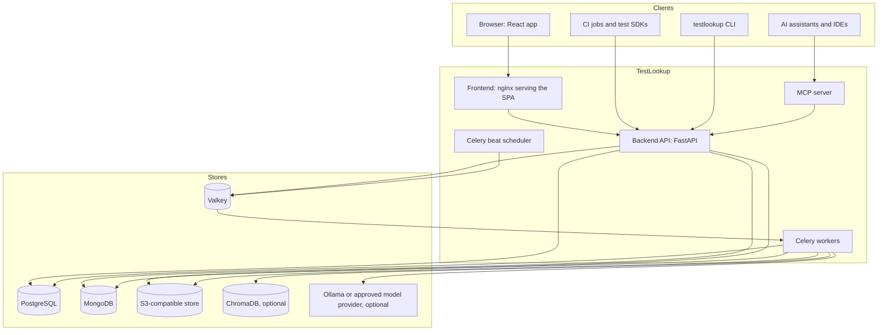

# TestLookup architecture

TestLookup is one Python backend codebase deployed as several processes (an API and Celery workers), a React single-page app, and an MCP server that adapts the API for AI assistants. Domain services share SQLAlchemy models and Pydantic contracts, so changes to a shared model ship together; it is a modular monolith, not a set of independently versioned microservices. Long-running work (parsing reports, running the analysis pipeline, sending notifications, housekeeping) happens in workers, never in HTTP handlers.

This page is the overview. Each section links to the detailed documents in [`docs/architecture/`](docs/architecture/overview.md), [`docs/pipelines/`](docs/pipelines/ingestion.md) and the engineering deep dives in [`architecture/`](architecture/README.md).

## System context

## Components

| Component | Technology | Responsibility | Code |
|---|---|---|---|
| Frontend | React 19, TypeScript, Vite; nginx in production | Pages, role-aware controls, charts, review and authoring UI. nginx serves the bundle and proxies `/api/`, `/ws/` and `/webhooks/` to the backend | `frontend/` ([frontend architecture](architecture/FRONTEND.md)) |
| Backend API | FastAPI, Pydantic 2, SQLAlchemy 2 (async), Motor | Authentication (JWT, API keys, SSO, SCIM tokens), authorization, validation, ingestion admission, orchestration, serialization. Swagger at `/api-docs` | `backend/app/main.py`, `backend/app/routers/`, `backend/app/services/` |
| Workers | Celery 5 with Valkey as broker | Parse and persist results, run the analysis pipeline, generate reports, notify, reconcile | `backend/app/worker/` |
| Scheduler | Celery beat (exactly one) | Periodic draining, reconciliation, digests, retention and maintenance | `backend/app/worker/celery_app.py` |
| Agent runtime | LangGraph | Versioned workflows, checkpoints, leases, budgets, tools, critic and human review | `backend/app/agents/` ([agentic runtime](architecture/AGENTIC_RUNTIME.md)) |
| MCP server | Model Context Protocol over stdio or SSE (port 8002) | Tools, resources and prompts for AI assistants, calling the API with the caller's own credentials | `mcp/` ([MCP README](mcp/README.md)) |
| CLI | Typer | Uploads, queries, reports and the `ci-verdict` gate for pipelines | `cli/` ([CLI README](cli/README.md)) |
| Client SDKs | Python (pytest plugin), Java (TestNG listener, JUnit 5 extension), JavaScript (Jest and Mocha reporters), Go | Stream results live or upload batches from test runs | `client/` ([client README](client/README.md)) |

## Data stores

Each store has one job. There is no transaction spanning stores: durable outboxes, idempotent identities, leases and reconciliation tasks keep them consistent after partial failures.

| Store | Holds | Notes |
|---|---|---|
| PostgreSQL 16 | The system of record: users and projects, runs and per-test executions, canonical tests and suites, releases and policies, reviews, agent state, outboxes, audit | Schema managed by Alembic (`backend/migrations/`); [data model](docs/architecture/data-model.md), [table reference](docs/reference/data-dictionary.md), [schema deep dive](architecture/DATABASE_SCHEMA.md) |
| MongoDB 7 | Rich evidence: raw and sanitized payloads, analysis reasoning, run summaries, decision documents | Collections and indexes in `backend/app/db/mongo.py`. Licensed SSPL-1.0; provide it yourself where you cannot use the upstream image |
| Valkey 8 | Celery broker and results, live-event streams and fan-out, session buffers, rate limits, caches, debounce sets | Needs persistence and an eviction policy that never evicts keys without a TTL ([requirements](docs/operations/deploy-openshift.md#external-valkey-or-redis-requirements)). Settings keep the `REDIS_*` names |
| S3-compatible object store | Queued uploads, report files and exports, compliance packs, knowledge documents, trained-model artifacts, training exports | versitygw in the shipped stacks; any S3 endpoint through the `MINIO_*` settings. A local-disk provider exists for development |
| ChromaDB (optional) | Embeddings for semantic search, knowledge retrieval and agent memory | Rebuildable from PostgreSQL; excluded from backups |
| Ollama (optional) | Local chat and embedding models (default `qwen2.5:7b-instruct` and `nomic-embed-text:v1.5`) | Other local servers (LM Studio, LocalAI, vLLM) and hosted providers (OpenAI, Gemini, Anthropic, OpenRouter) are supported; hosted ones are blocked while `AI_OFFLINE_MODE=true` |

## Ingestion path

```mermaid
flowchart LR
  Input[File upload, JSON batch, live events, storage sentinel] --> Auth[Authenticate and resolve project]
  Auth --> Admission[Validate, rate-limit, broker-memory backpressure]
  Admission --> Queue[Store payload and dispatch a Celery task]
  Queue --> Parse[Detect format, parse, normalize]
  Parse --> Persist[Persist run, executions and evidence]
  Persist --> Finalize[Finalize: aggregates, suites, history, release attribution]
  Finalize --> Outbox[Durable downstream intents]
  Outbox --> Analysis[Analysis pipeline and notifications]
```

1. **Entry.** `POST /api/v1/ingest/file` (multipart report, up to 50 MiB, ZIP archives allowed), `POST /api/v1/ingest` (JSON batch), the live streaming endpoints used by the SDKs, or an object-storage sentinel webhook.
2. **Admission.** The API authorizes the caller for the project, then applies the per-project batch budget and broker-memory backpressure, answering `429` or `503` with a reason instead of accepting work it cannot finish.
3. **Queueing.** File and JSON payloads are written to object storage and a task goes to the `ingestion` queue; the API returns `202` with a task ID (`GET /api/v1/ingest/uploads/{task_id}` reports progress). Live events go to per-session Valkey streams and are persisted by consumers on sharded ingestion queues.
4. **Parsing and persistence.** Workers detect the format (JUnit, TestNG, NUnit, xUnit.net, TRX, pytest, Robot Framework, Cucumber, Allure, Cypress, Playwright), normalize results, collapse duplicate test identities and store the run.
5. **Finalization.** Every stored run is finalized: aggregates, suite membership, history, release attribution and auto-tagging, then durable outbox entries trigger analysis and notifications.

Details: [ingestion pipeline](docs/pipelines/ingestion.md), [test-run lifecycle](docs/pipelines/test-runs.md), [ingestion at scale](architecture/INGESTION_SCALE.md).

## Workers and queues

| Queue | Work | Consumer |
|---|---|---|
| `critical` | Time-sensitive live analysis | `worker` (Compose) / `testlookup-worker-critical` (Kubernetes) |
| `ingestion`, `ingestion.shard.0` to `.7` | Report parsing, live-session persistence by project shard | `worker` / `testlookup-worker-ingestion` |
| `ai_analysis` | The analysis pipeline, comparisons, generation | `worker` / `testlookup-worker-ai` |
| `default` | Notifications, snapshots, training, maintenance | `worker` / `testlookup-worker-default` |
| `agent_children` | Bounded child investigations spawned by a parent pipeline | `worker-children` / `testlookup-worker-children`, isolated so parents waiting on children cannot starve them |

Workers acknowledge late and prefetch one task at a time, so a crashed worker's task is redelivered. Queue declarations and worker subscriptions must match in every deployment: [worker operations](docs/reference/worker-operations.md), [shard count changes](docs/operations/ingestion-shard-count-change.md), [database connection budget](docs/operations/database-connection-budget.md).

## Analysis pipeline

Analysis consumes stored evidence; not every stage calls a language model.

- **Routing.** Each failure is classified by the rules engine, a trained classifier or a model, chosen by `ANALYSIS_MODE` (`auto` by default). In `auto`, a missing or unreachable model falls back to ML, then rules, and the routing decision is recorded so the UI can say why a test was classified a certain way.
- **Offline graph** (every finalized run with failures): ingestion context, anomaly detection, root-cause analysis and a summary with a release recommendation; all-green runs skip straight to the summary.
- **Deep graph** (on demand or by policy): adds failure clustering, bounded child investigations per cluster, specialist stages (logs, regression, ownership, contracts, defects), gap detection, flaky and test-health signals, release risk, a signed decision report and a critic that checks it before publication.
- **Governance.** Per-project policies, budgets (runs, tokens, cost, time), a frozen configuration per run, provider allow-lists and the `AI_OFFLINE_MODE` egress ceiling. Reports can require human review before distribution; action proposals are recorded, never executed silently.

Details: [AI pipeline](docs/pipelines/ai.md), [AI quality](architecture/AI_QUALITY.md), [AI evaluation](architecture/AI_EVALUATION.md), [release gate](architecture/RELEASE_GATE.md), [flaky intelligence](architecture/FLAKY_INTELLIGENCE.md), [knowledge retrieval](architecture/KNOWLEDGE_RAG.md), [reporting](docs/pipelines/reporting.md).

## Interfaces

- **REST API** under `/api/v1`, documented by OpenAPI at `/api-docs`; the generated [endpoint index](docs/reference/api-index.md) and [API guide](docs/api/README.md) cover authentication and errors.
- **Live updates** to the browser over WebSocket and server-sent events.
- **MCP server** for AI assistants: stdio for local clients, SSE with a bearer token for remote ones.
- **CLI and SDKs** as listed above; the [CLI, SDK and MCP guide](user-guide/cli-sdk-mcp.md) shows how to use them.
- **Outbound integrations**: Jira, GitHub and GitLab, Slack, Microsoft Teams and email, outbound webhooks; each one is off until configured and respects `AI_OFFLINE_MODE` where it leaves the network. [Integration map](docs/architecture/integrations.md).

## Security model

Five roles (`VIEWER`, `TESTER`, `QA_ENGINEER`, `QA_LEAD`, `ADMIN`), project membership and API-key scopes are checked on every request; production startup refuses placeholder secrets and passwordless development login. [Security architecture](docs/architecture/security.md), [security deep dive](architecture/SECURITY.md), [threat model](THREAT_MODEL.md).

## Deployment and operations

The same three images (backend, frontend, MCP) run under Docker Compose, Kubernetes (generic, EKS, GKE, AKS, OpenShift, single-node K3s) and fully air-gapped installs. Health endpoints (`/health/live`, `/health/ready`, `/health/version`, `/health/details`), Prometheus metrics and optional OpenTelemetry tracing support operations. [Deployment guide](docs/operations/deployment.md), [deployment topologies](architecture/DEPLOYMENT.md), [observability](architecture/OBSERVABILITY.md).

## Further reading

- [Design decisions and trade-offs](docs/architecture/design-decisions.md)
- [Codebase map](docs/architecture/codebase-map.md)
- [Developer guide](architecture/DEVELOPER_GUIDE.md): conventions, quality gates and recurring bug classes
- [Configuration reference](docs/operations/configuration.md), and the [API](docs/reference/api-index.md) and [settings](docs/reference/configuration.md) references generated from the source
