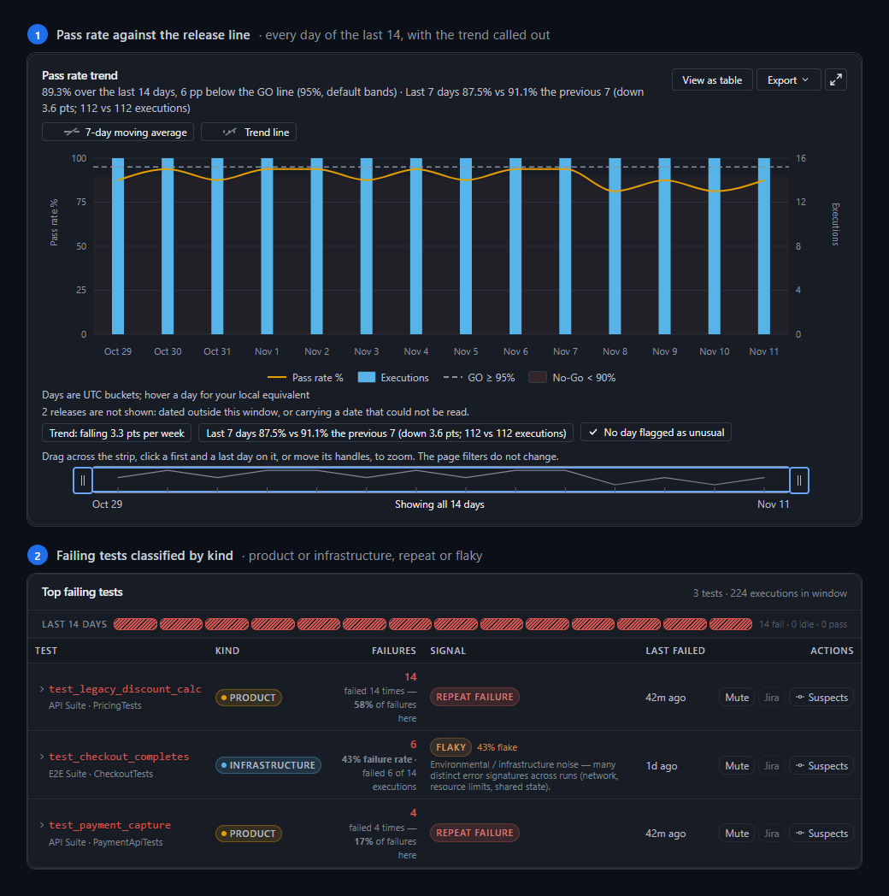
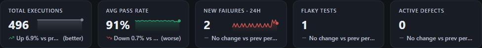
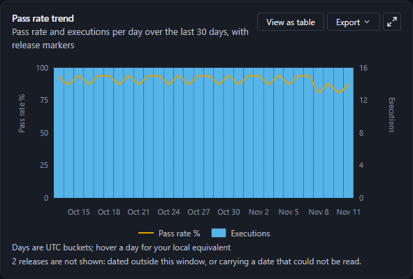
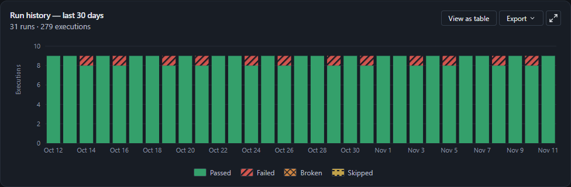
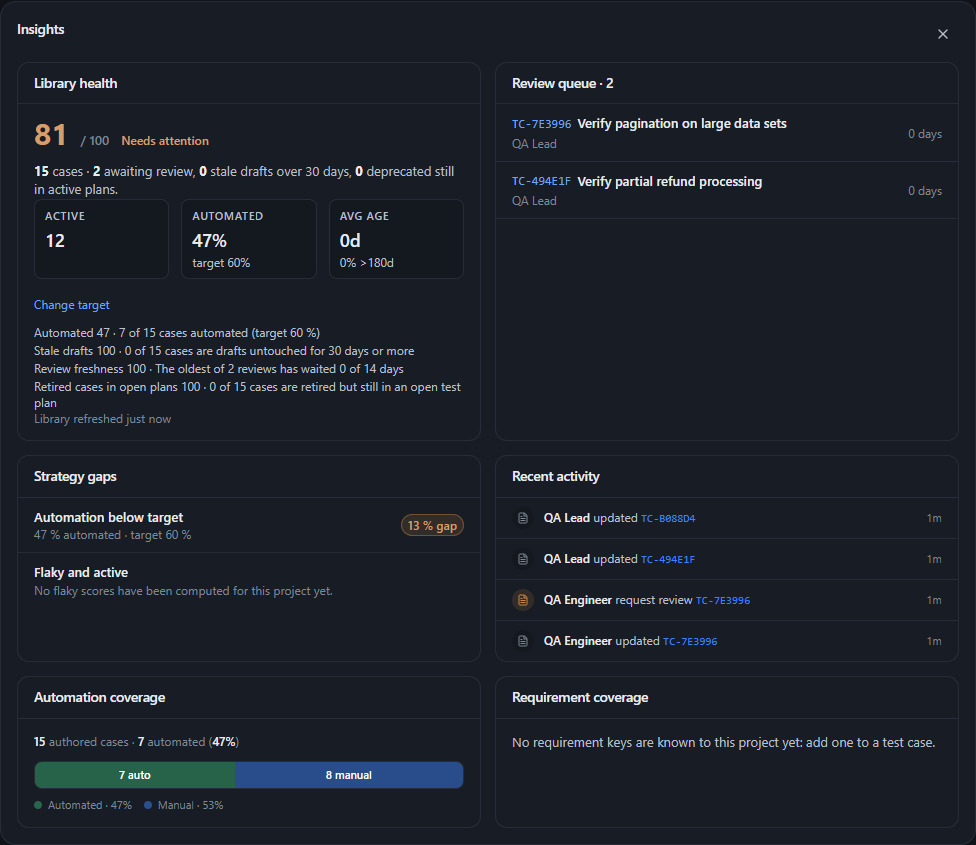
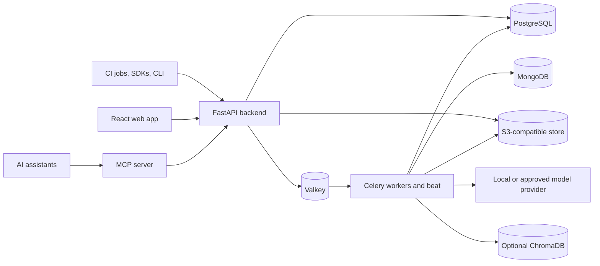

<p align="center">
  <picture>
    <source media="(prefers-color-scheme: dark)" srcset="docs/product/brand/wordmark-dark.svg">
    
  </picture>
</p>

<p align="center">
  <b>Know why your software tests fail. Know when to ship.</b><br>
  Open-source software test intelligence: manage test reports and software test releases, find the issues behind failing tests, and decide each release with evidence.
</p>

<p align="center">
  <a href="https://testlookup.app"><b>Website</b></a> ·
  <a href="https://testlookup.app/docs/">Docs</a> ·
  <a href="#run-it-in-one-command">Quick start</a> ·
  <a href="https://testlookup.app/demo/"><b>Demo</b></a> ·
  <a href="https://testlookup.app/features/">Features</a> ·
  <a href="https://testlookup.app/roadmap/">Roadmap</a>
</p>

<p align="center">
  <a href="https://github.com/test-intelligence/testlookup/actions/workflows/ci.yml"></a>
  <a href="https://scorecard.dev/viewer/?uri=github.com/test-intelligence/testlookup"></a>
  <a href="LICENSE"></a>
  <a href="https://github.com/orgs/test-intelligence/packages?repo_name=testlookup"></a>
  <a href="https://codespaces.new/test-intelligence/testlookup?quickstart=1"></a>
</p>

<p align="center">
  
</p>

TestLookup collects the test reports your CI already produces, keeps their history per project, classifies why each test fails, and turns that evidence into a release recommendation you can audit. It runs on your own servers, and its AI analysis defaults to a local model, with hosted model providers blocked until you allow them.

## Run it in one command

You need Docker with Compose v2 and Bash (on Windows, Git Bash or WSL). This installs the published images with demo projects, so your first dashboard already has data:

```bash
curl -fsSL https://raw.githubusercontent.com/test-intelligence/testlookup/main/install.sh | TL_PROFILE=demo bash
```

- **Time and size:** the images are about 1 GB to download (0.95 GB for linux/amd64, measured on 11 November 2026). On a 100 Mbit/s connection, expect about 5 minutes from the command to a working dashboard. Leave about 8 GB of memory free for the services.
- **Then:** open [localhost:3000](http://localhost:3000) and sign in as `admin` with the password the installer prints. It is also saved in `testlookup/.env` as `INITIAL_ADMIN_PASSWORD`, and you choose a new one at the first sign-in. The demo projects load in the background after the database is ready.
- **What it does:** downloads the release Compose file into `./testlookup`, writes a `.env` with random secrets in production mode (no passwordless login), and starts the stack. Read [install.sh](install.sh) first if your policy asks you to. Leave out `TL_PROFILE=demo` to start with an empty instance for your team.

Nothing to install? Replay real screens in the browser with the [guided tours](https://testlookup.app/demo/) (first run, failure triage, release review), or [open a Codespace](https://codespaces.new/test-intelligence/testlookup?quickstart=1) that starts the full app with demo data on your GitHub account's Codespaces allowance.

## What you get in the first five minutes

1. **Your results in one place.** Upload a JUnit XML report (or use the demo projects) and see the run with its history.
2. **Failures with a reason.** Each failing test is classified (product, test data, automation, flaky or infrastructure) and grouped with the failures that share its error signature.
3. **A release verdict.** The run gets a GO, CONDITIONAL_GO or NO_GO recommendation, with the policy and evidence behind it.

## Feature tour

<p align="center">
  
</p>
<p align="center">
  
  
</p>
<p align="center">
  
</p>

<sub>Screenshots: captured on 11 November 2026 from the images built at commit 347f5abd, with seeded demo data and one demo run a day. See [docs/product/screenshots](docs/product/screenshots/README.md).</sub>

- **Collect results** by uploading report files (UI, CLI or API), posting JSON batches, streaming live from the Python, Java, JavaScript and Go SDKs, or dropping files into object storage. Supported formats: JUnit XML, TestNG, NUnit, xUnit.net, Visual Studio TRX, pytest, Robot Framework, Cucumber, Allure, Cypress and Playwright, with automatic format detection.
- **Overview and trends**: pass rate, executions, new failures, flaky tests and defects per project, with release markers, coverage maps, heatmaps and an explorer for comparing suites, environments and releases.
- **Failure analysis**: every failure is classified with a confidence and the evidence behind it, grouped into clusters by error signature, and compared against previous runs to separate regressions from known problems.
- **Flaky tests**: flakiness scores from run history, with an optional quarantine workflow so known-flaky tests stop blocking pipelines (`testlookup ci-verdict` in CI).
- **Release gate**: a GO / CONDITIONAL_GO / NO_GO recommendation per run or release, driven by policies you configure, with recorded overrides and a decision trail.
- **Ask AI and deep investigation**: chat about a run or project with answers grounded in its stored evidence, and multi-step investigations that run under per-project budgets and policies.
- **Test management**: authored test cases, plans and strategies with a reviewed lifecycle, linked to the executions they describe.
- **Reports and sharing**: summary reports, PDF and Excel exports, evidence bundles, share links and compliance packs, with an optional human-review gate before AI-generated content is distributed.
- **Integrations**: Jira, GitHub and GitLab (checks and merge-request notes), Slack, Microsoft Teams and email notifications, outbound webhooks, and knowledge sources for retrieval.
- **Access control**: five roles (`VIEWER`, `TESTER`, `QA_ENGINEER`, `QA_LEAD`, `ADMIN`) plus project membership, API keys, MFA, SAML and OpenID Connect single sign-on, and SCIM provisioning.

Some features ship turned off and are enabled per installation or project with feature flags; the in-app guide (`/docs` on your instance) describes each one.

## Why TestLookup

A CI system tells you that a build went red. It does not tell you whether the 37 failures are one broken service, a flaky test that has failed twice a week since spring, an expired test certificate, or a real regression in the code you are about to ship. Answering that usually means opening logs across several pipelines and keeping notes in a spreadsheet.

TestLookup is built for the people who answer that question: **test and automation engineers** telling product bugs from test-data, automation, flaky and infrastructure failures; **QA leads** who sign off releases and need an evidence trail; **developers and service owners** investigating failures in the code they own; and **platform teams** who want one place for results from Jenkins, GitHub Actions, GitLab and anything else that produces a report.

### How it differs from what you may already use

| | CI dashboards (Jenkins, GitHub Actions, GitLab CI) | Report generators (for example Allure Report) | TestLookup |
|---|---|---|---|
| Scope | One pipeline's runs | A report per test run (with trend history if you carry it between runs) | Every run from every CI, per project, over time |
| Test identity across runs | Per job | Per report | Canonical test identities across runs, suites and branches |
| Failure triage | Logs | Steps, attachments, categories you define | Classification (product, test data, automation, flaky, infrastructure), failure clusters, regression comparison |
| Release decisions | Pass/fail of a pipeline | Not in scope | GO / CONDITIONAL_GO / NO_GO with configurable policies, overrides and a decision history |
| AI | Varies by vendor | Not in scope | Optional, local by default, with provenance and human review |

TestLookup ingests Allure results and JUnit-style output from those tools; it complements them rather than replacing the CI system. Self-hosted results servers such as ReportPortal also keep cross-run history; TestLookup's emphasis is release gating with an audit trail, offline-first AI with a hard egress switch, and an MCP server so AI assistants can query results with the caller's own permissions.

### Offline-first: your data stays local

- Results, logs, analyses and decisions are stored in PostgreSQL, MongoDB and an S3-compatible store that you run.
- `AI_OFFLINE_MODE=true` is the default. It blocks hosted model providers and other outbound AI calls, while local endpoints such as [Ollama](https://ollama.com) keep working. The default local model is `qwen2.5:7b-instruct` (Apache-2.0).
- Without any model, analysis still works through the built-in rules and ML classifiers; models add explanations and summaries on top.
- An [offline bundle](user-guide/air-gapped-install.md) installs TestLookup on networks with no internet access (MongoDB, licensed SSPL-1.0, is mirrored separately).

## Install options

The website's [quick start](https://testlookup.app/docs/next/quickstart/) uses the same two options. Pick one: both use the same ports and container names, so only one copy runs on a machine. Both need Docker with Compose v2 and Bash, about 8 GB of free memory, and free ports 3000, 8000, 8002, 5433, 6379, 9000 and 27017; see the [sizing guide](user-guide/sizing.md) for disk.

### Option A: one-command install (published images)

The [command above](#run-it-in-one-command). It pulls `ghcr.io/test-intelligence/testlookup` images and builds nothing. Sign-in is always `admin` with the printed password. Other settings (`TESTLOOKUP_VERSION` to pin an image tag, `TL_PROFILE=local-llm` for local models, `TL_DIR`, `TL_NO_UP`) are in the [Compose guide](docs/operations/deploy-compose.md#release-images-without-a-clone). No release has been tagged yet, so the default image tag, `latest`, follows the newest build of `main`.

### Option B: build from a clone (development)

Needs Git and GNU Make as well. The sample upload step runs `curl` and `python3` on your machine.

```bash
git clone https://github.com/test-intelligence/testlookup.git
cd testlookup
make quickstart
```

`make quickstart` writes a development `.env` with random secrets, builds and starts the stack, loads demo projects and uploads the sample reports from `samples/junit/`. It builds every image from source, so allow 10 minutes or more the first time (CI's own build of the three app images takes about 9 minutes). Because it runs in development mode, the login page shows **Quick Login** buttons that need no password; choose **Admin**. To add local models, run `make dev-llm` instead: it pulls `qwen2.5:7b-instruct` (default, Apache-2.0), `qwen2.5:14b-instruct-q5_K_M` and `nomic-embed-text:v1.5`.

Both options serve the dashboard at [localhost:3000](http://localhost:3000), the in-app guide at `/docs` and the API reference at [localhost:8000/api-docs](http://localhost:8000/api-docs). A step-by-step first run, from sign-in to your own report: [GETTING_STARTED.md](GETTING_STARTED.md).

### Beyond one machine: Kubernetes and OpenShift

Provide PostgreSQL, MongoDB, Valkey (or another Redis-compatible broker) and S3-compatible storage, create the `testlookup-secrets` Secret, then deploy an overlay; the script runs the database migration before the rollout:

```bash
scripts/deploy-k8s.sh --cloud=self-hosted --image-tag=<release tag or commit SHA>
```

The manifests pull the published images from `ghcr.io/test-intelligence/testlookup`; `--registry` points them at your own mirror. Overlays exist for generic clusters, EKS, GKE, AKS, OpenShift (including an air-gapped Artifactory variant) and single-node K3s. Start with the [Kubernetes guide](docs/operations/deploy-kubernetes.md) or the [single-node K3s guide](docs/operations/deploy-k3s.md). Every mode, its required secrets, TLS, backups and upgrades: [deployment guide](docs/operations/deployment.md).

## Send your first results

From CI, or any machine that can reach the API, upload a report with a project API key (create it under **Settings › Account › My API keys**):

```bash
curl --fail-with-body http://localhost:8000/api/v1/ingest/file \
  -H "X-API-Key: $TL_API_KEY" \
  -F project_id=<project-id> -F build_number=<build> -F format=auto -F file=@results.xml
```

The CLI does the same with `testlookup upload file results.xml -p <project-id> -b <build>`; it is not on PyPI, so install it from your deployment (the in-app getting-started guide shows the command) or from a clone with `pip install -e cli/`. The [API guide](docs/api/README.md) has copy-paste requests, and the [CLI, SDK and MCP guide](user-guide/cli-sdk-mcp.md) covers the live reporters for pytest, TestNG/JUnit 5, Jest/Mocha and Go.

## Architecture at a glance



Ingestion, analysis and reporting run in Celery workers; the API answers quickly and returns task IDs. Details: [ARCHITECTURE.md](ARCHITECTURE.md).

## Documentation

| You want to | Start here |
|---|---|
| Use TestLookup | The in-app guide at `/docs` on your instance, [product overview](docs/product/overview.md), [user journeys](docs/product/workflows.md) |
| Install and operate it | [Deployment guide](docs/operations/deployment.md), [operator guide](user-guide/README.md), [sizing](user-guide/sizing.md), [upgrading](UPGRADING.md) |
| Integrate CI, SDKs or AI assistants | [API guide](docs/api/README.md), [all endpoints](docs/reference/api-index.md), [CLI, SDKs and MCP](user-guide/cli-sdk-mcp.md) |
| Understand or change the code | [Architecture](ARCHITECTURE.md), [codebase map](docs/architecture/codebase-map.md), [contributing](CONTRIBUTING.md) |

The full index by audience is [docs/README.md](docs/README.md).

## Community

- **Contribute:** issues labelled [good first issue](https://github.com/test-intelligence/testlookup/labels/good%20first%20issue) and [help wanted](https://github.com/test-intelligence/testlookup/labels/help%20wanted) are a good start. [CONTRIBUTING.md](CONTRIBUTING.md) covers the development setup, tests and the DCO sign-off (`git commit -s`).
- **Ask and report:** [getting help](SUPPORT.md), the bug and feature forms in [issues](https://github.com/test-intelligence/testlookup/issues/new/choose), and the [Code of Conduct](CODE_OF_CONDUCT.md).
- **Security:** report vulnerabilities privately, not in issues; see the [security policy](SECURITY.md).
- **Project:** [governance](GOVERNANCE.md), [maintainers](MAINTAINERS.md), [changelog](CHANGELOG.md) and the [roadmap](https://testlookup.app/roadmap/).

## Built by

<!--
  MAINTAINER CARD: placeholder, for the project lead to fill in.
  Add your photo, name, a one-line role and your links (GitHub, LinkedIn,
  personal site), for example:
    .png" width="72" align="left" alt="">
    **<Your name>**, <role>. <one line on what you focus on>.
    [GitHub](...) · [LinkedIn](...) · [Website](...)
  Nothing here is filled in on the maintainer's behalf.
-->
TestLookup is an independent open-source project led by [@anandtopu](https://github.com/anandtopu). See [MAINTAINERS.md](MAINTAINERS.md) for who reviews and merges changes, and [GOVERNANCE.md](GOVERNANCE.md) for how decisions are made.

## License

TestLookup is licensed under the [Apache License 2.0](LICENSE). See [NOTICE](NOTICE) for attribution. Third-party services it runs alongside, such as MongoDB (SSPL-1.0), keep their own licenses. [THIRD_PARTY_NOTICES.md](THIRD_PARTY_NOTICES.md) lists the software TestLookup uses; every TestLookup image carries it with LICENSE and NOTICE under `/licenses`, and the web UI serves the license texts of its bundled JavaScript at `/THIRD_PARTY_LICENSES.txt`. The software is provided "AS IS", without warranties or conditions of any kind (Apache-2.0, sections 7 and 8).
