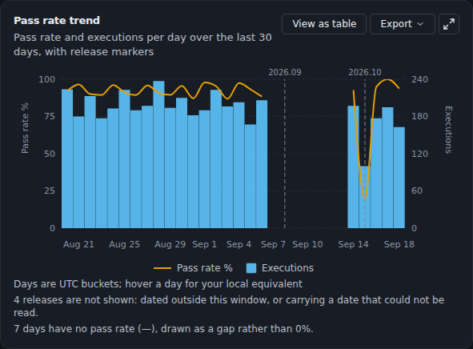
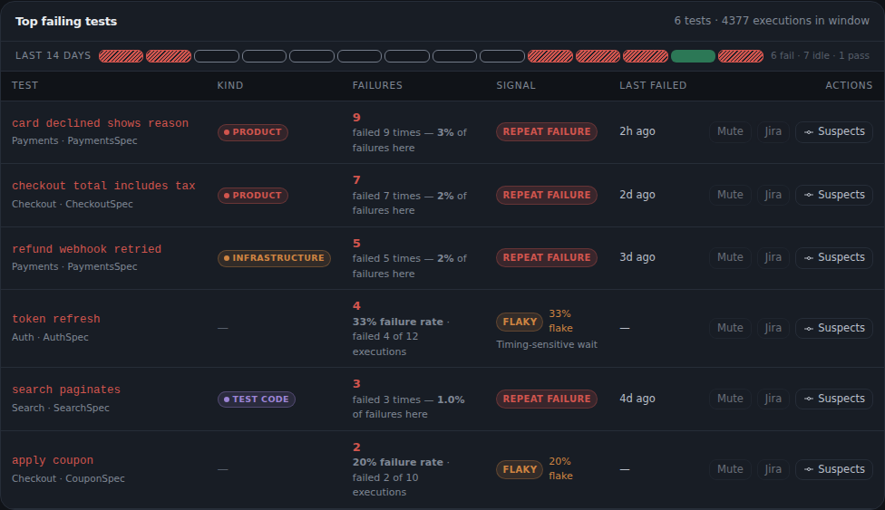
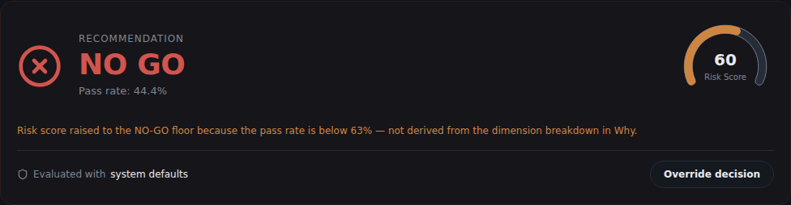
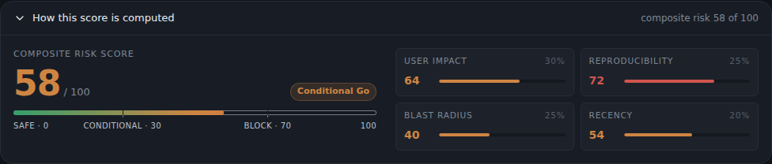
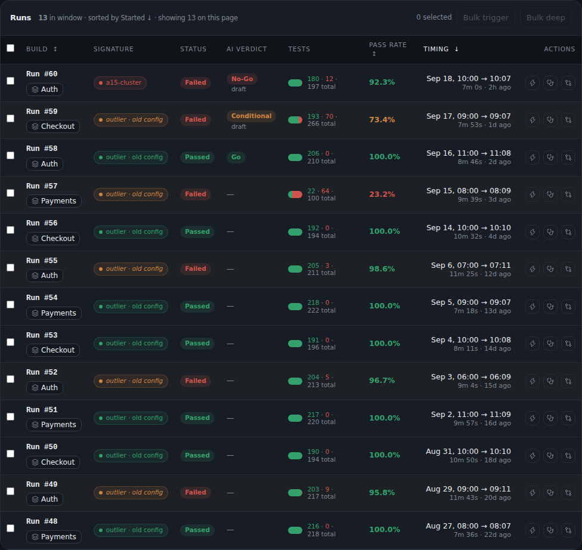
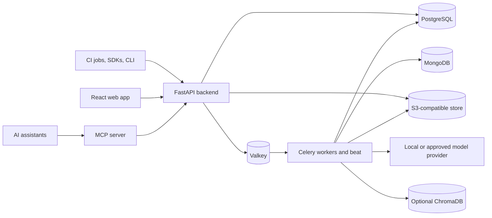

<p align="center">
  
</p>

<p align="center">
  <b>Self-hosted test-result intelligence: collect results from every CI, explain failures, decide releases.</b>
</p>

<p align="center">
  <a href="https://github.com/test-intelligence/testlookup/actions/workflows/ci.yml"></a>
  <a href="LICENSE"></a>
  <a href="docs/README.md"></a>
</p>

TestLookup collects test results from your test frameworks and CI systems, keeps their history per project, classifies why tests fail, and turns that evidence into a release recommendation you can audit. It runs on your own infrastructure: a web app, a REST API, a CLI, client SDKs and an MCP server for AI assistants, backed by databases you control. AI analysis defaults to a local model, and hosted model providers stay blocked unless you turn them on.

## Why TestLookup

A CI system tells you that a build went red. It does not tell you whether the 37 failures are one broken service, a flaky test that has failed twice a week since spring, an expired test certificate, or a real regression in the code you are about to ship. Answering that usually means opening logs across several pipelines and keeping notes in a spreadsheet.

TestLookup is built for the people who answer that question:

- **Test and automation engineers** who need to tell product bugs from test-data, automation, flaky and infrastructure failures.
- **QA leads** who sign off releases and need an evidence trail behind each decision.
- **Developers and service owners** investigating failures in the code they own.
- **Platform teams** who want one place for results from Jenkins, GitHub Actions, GitLab and anything else that produces a report.

### Offline-first: your data stays local

- Results, logs, analyses and decisions are stored in PostgreSQL, MongoDB and an S3-compatible store that you run.
- `AI_OFFLINE_MODE=true` is the default. It blocks hosted model providers and other outbound AI calls, while local endpoints such as [Ollama](https://ollama.com) keep working. The default local model is `qwen2.5:7b-instruct` (Apache-2.0).
- Without any model, analysis still works through the built-in rules and ML classifiers; models add explanations and summaries on top.
- An [offline bundle](user-guide/air-gapped-install.md) installs TestLookup on networks with no internet access (MongoDB, licensed SSPL-1.0, is mirrored separately).

### How it differs from what you may already use

| | CI dashboards (Jenkins, GitHub Actions, GitLab CI) | Report generators (for example Allure Report) | TestLookup |
|---|---|---|---|
| Scope | One pipeline's runs | A report per test run (with trend history if you carry it between runs) | Every run from every CI, per project, over time |
| Test identity across runs | Per job | Per report | Canonical test identities across runs, suites and branches |
| Failure triage | Logs | Steps, attachments, categories you define | Classification (product, test data, automation, flaky, infrastructure), failure clusters, regression comparison |
| Release decisions | Pass/fail of a pipeline | Not in scope | GO / CONDITIONAL_GO / NO_GO with configurable policies, overrides and a decision history |
| AI | Varies by vendor | Not in scope | Optional, local by default, with provenance and human review |

TestLookup ingests Allure results and JUnit-style output from those tools; it complements them rather than replacing the CI system. Self-hosted results servers such as ReportPortal also keep cross-run history; TestLookup's emphasis is release gating with an audit trail, offline-first AI with a hard egress switch, and an MCP server so AI assistants can query results with the caller's own permissions.

## Feature tour

<p align="center">
  
  
</p>
<p align="center">
  
  
</p>
<p align="center">
  
</p>

<sub>Screenshots are the CI visual-regression baselines, rendered from seeded demo data.</sub>

- **Collect results** by uploading report files (UI, CLI or API), posting JSON batches, streaming live from the Python, Java, JavaScript and Go SDKs, or dropping files into object storage. Supported formats: JUnit XML, TestNG, NUnit, xUnit.net, Visual Studio TRX, pytest, Robot Framework, Cucumber, Allure, Cypress and Playwright, with automatic format detection.
- **Overview and trends**: pass rate, executions, new failures, flaky tests and defects per project, with release markers, coverage maps, heatmaps and an explorer for comparing suites, environments and releases.
- **Failure analysis**: every failure is classified with a confidence and the evidence behind it, grouped into clusters by error signature, and compared against previous runs to separate regressions from known problems.
- **Flaky tests**: flakiness scores from run history, with an optional quarantine workflow so known-flaky tests stop blocking pipelines (`testlookup ci-verdict` in CI).
- **Release gate**: a GO / CONDITIONAL_GO / NO_GO recommendation per run or release, driven by policies you configure, with recorded overrides and a decision trail.
- **Ask AI and deep investigation**: chat about a run or project with answers grounded in its stored evidence, and multi-step investigations that run under per-project budgets and policies.
- **Test management**: authored test cases, plans and strategies with a reviewed lifecycle, linked to the executions they describe.
- **Reports and sharing**: summary reports, PDF and Excel exports, evidence bundles, share links and compliance packs, with an optional human-review gate before AI-generated content is distributed.
- **Integrations**: Jira, GitHub and GitLab (checks and merge-request notes), Slack, Microsoft Teams and email notifications, outbound webhooks, and knowledge sources for retrieval.
- **Access control**: five roles (`VIEWER`, `TESTER`, `QA_ENGINEER`, `QA_LEAD`, `ADMIN`) plus project membership, API keys, MFA, SAML single sign-on and SCIM provisioning.

Some features ship turned off and are enabled per installation or project with feature flags; the in-app guide (`/docs` on your instance) describes each one.

## Quick start

Pick one of three ways in. All of them need Docker with Compose v2; see the [sizing guide](user-guide/sizing.md) for memory and disk.

### 1. From a clone (demo data included)

Needs Git, GNU Make and Bash (on Windows, use Git Bash or WSL).

```bash
git clone https://github.com/test-intelligence/testlookup.git
cd testlookup
make quickstart
```

`make quickstart` generates a local `.env` with random secrets, builds and starts the stack, loads demo projects and uploads sample results. Open the dashboard at [localhost:3000](http://localhost:3000) and use the Quick Login buttons (development mode only). The API reference is at [localhost:8000/api-docs](http://localhost:8000/api-docs).

To add local models, run `make dev-llm` instead. `make dev-llm` waits for Ollama and pulls the pinned models: `qwen2.5:7b-instruct` (default, Apache-2.0), `qwen2.5:14b-instruct-q5_K_M` and `nomic-embed-text:v1.5`. Download time and inference speed depend on your hardware.

### 2. Without a clone (published images)

```bash
curl -fsSL https://raw.githubusercontent.com/test-intelligence/testlookup/main/install.sh | bash
```

The installer downloads the release Compose file, generates a production-mode `.env` with random secrets and pulls the images from `ghcr.io/test-intelligence/testlookup`. It prints the admin login once (user `admin`); the password is stored in `.env` as `INITIAL_ADMIN_PASSWORD`, and you choose a new one at the first sign-in. Options (`TL_PROFILE=demo`, `TESTLOOKUP_VERSION`, ...) are in the [Compose guide](docs/operations/deploy-compose.md#release-images-without-a-clone).

### 3. Kubernetes

Provide PostgreSQL, MongoDB, Valkey (or another Redis-compatible broker) and S3-compatible storage, create the `testlookup-secrets` Secret, then deploy an overlay; the script runs the database migration before the rollout:

```bash
scripts/deploy-k8s.sh --cloud=self-hosted --registry=ghcr.io/test-intelligence --image-tag=<release tag or commit SHA>
```

Overlays exist for generic clusters, EKS, GKE, AKS, OpenShift (including an air-gapped Artifactory variant) and single-node K3s. Start with the [Kubernetes guide](docs/operations/deploy-kubernetes.md) or the [single-node K3s guide](docs/operations/deploy-k3s.md).

Every mode, its required secrets, TLS, backups and upgrades: [deployment guide](docs/operations/deployment.md). A guided first run: [GETTING_STARTED.md](GETTING_STARTED.md).

## Send your first results

```bash
pip install -e cli/
export TESTLOOKUP_URL=http://localhost:8000 TESTLOOKUP_API_KEY=qai_your_api_key_here
testlookup upload file results.xml -p <project-id> -b <build>
```

Create the API key under **Settings → API Keys**. CI pipelines can call the ingest API directly instead; the [API guide](docs/api/README.md) has copy-paste requests, and the [CLI, SDK and MCP guide](user-guide/cli-sdk-mcp.md) covers the reporters for pytest, TestNG/JUnit 5, Jest/Mocha and Go.

## Architecture at a glance



Ingestion, analysis and reporting run in Celery workers; the API answers quickly and returns task IDs. Details: [ARCHITECTURE.md](ARCHITECTURE.md).

## Documentation

| You want to | Start here |
|---|---|
| Use TestLookup | The in-app guide at `/docs` on your instance, [product overview](docs/product/overview.md), [user journeys](docs/product/workflows.md) |
| Install and operate it | [Deployment guide](docs/operations/deployment.md), [operator guide](user-guide/README.md), [sizing](user-guide/sizing.md), [upgrading](UPGRADING.md) |
| Integrate CI, SDKs or AI assistants | [API guide](docs/api/README.md), [all endpoints](docs/reference/api-index.md), [CLI, SDKs and MCP](user-guide/cli-sdk-mcp.md) |
| Understand or change the code | [Architecture](ARCHITECTURE.md), [codebase map](docs/architecture/codebase-map.md), [contributing](CONTRIBUTING.md) |

The full index by audience is [docs/README.md](docs/README.md).

## Community

- [Contributing](CONTRIBUTING.md): development setup, tests, and the DCO sign-off (`git commit -s`).
- [Getting help](SUPPORT.md) and [Code of Conduct](CODE_OF_CONDUCT.md).
- [Security policy](SECURITY.md): report vulnerabilities privately, not in issues.
- [Governance](GOVERNANCE.md) and [maintainers](MAINTAINERS.md).

## License

TestLookup is licensed under the [Apache License 2.0](LICENSE). See [NOTICE](NOTICE) for attribution. Third-party services it runs alongside, such as MongoDB (SSPL-1.0), keep their own licenses.
