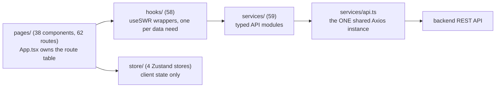

# Frontend — SPA architecture

> Companion to [README.md](./README.md). The React 18 + Vite + TypeScript SPA:
> its layering, state model, theme system, and the CI ratchets that hold the
> conventions in place. Verified against the implementation 2026-08-08; the
> theme system and the CI rules (§4, §5) re-verified 2026-10-18 (W29a) and
> 2026-10-19 (W29b: the type scale, one table, one panel header and KPI tile,
> one chart text style).

## 1. Layering

One direction of data flow, enforced by quality gates (§5):

- **Pages** are route-level components (`App.tsx` is the single route table —
  check it before editing a page; files get renamed).
- **Hooks** wrap `useSWR` and are the only way pages read server data. A
  page-level data need = a hook; hooks call services, never Axios directly.
- **Services** are typed API modules; every one imports the shared base from
  `services/api.ts` — no ad-hoc `axios.create` anywhere.
- **Reads via SWR, writes via service calls + `mutate`** — optimistic updates
  revalidate the affected SWR keys rather than duplicating server state.

## 2. The shared Axios instance (`services/api.ts`)

Both interceptors carry deliberate policy:

- **Request** — attaches auth; base URL is empty when `VITE_API_BASE_URL` is
  unset, making the production bundle deploy-target agnostic (same-origin
  relative URLs behind any ingress — see
  [DEPLOYMENT.md](./DEPLOYMENT.md)).
- **Response** — on 401, a **single-flight token refresh** (one refresh even
  when many requests fail together, with a queue that replays the rest); then
  the toast policy in `services/apiErrors.ts`: **422s toast** (a silent 422 was
  the historical "empty page, no error" footgun), 401/404 stay quiet, and
  FastAPI's array-form validation `detail` is flattened into a readable
  message instead of `[object Object]`.

## 3. Client state — Zustand, and only client state

Four stores, all cross-cutting *client* concerns — server data never lives in
Zustand:

| Store | Holds |
|---|---|
| `authStore` | the session user + token lifecycle |
| `projectStore` | the active project (`ALL_PROJECTS_ID` sentinel is a named constant — never inline the string) |
| `themeStore` | the selected theme |
| `timeWindowStore` | the **global shared time window** — one window across all analytics pages; each page snaps it to its allowed set (pages must agree on the canonical values or they drift each other) |

Selector discipline: components select **primitive slices**
(`useAuthStore(s => s.user?.role)`) so Zustand's `Object.is` equality prevents
re-render storms; object-returning selectors were a real bug class.

## 4. The theme system

Seven themes are CSS custom-property sets under `[data-theme="…"]` in
`src/index.css`: five dark ones (`signal`, the default, `console`, `slate`,
`ember`, `midnight`) and two light ones, `lab` and `paper` (W29a, OR-06:
"Soft light · low glare", a warm `#EAE8E2` page, `#F5F4F0` cards, softened
`#26292E` text, muted text at 4.5:1 or better on every surface and a `#2F5FB3`
accent, for long reading sessions). The registry is `THEMES` in
`store/themeStore.ts` (id, label, hint and the picker swatch); `THEME_IDS` lists
the ids in picker order and `LIGHT_THEMES` / `isLightTheme` name the light ones,
which every contrast test and the solid destructive button key on. A theme is a
`data-theme` value only: nothing is sent to the server. The chart export's
**Light background** always re-resolves on Lab's white card, whichever theme is
active (`EXPORT_LIGHT_THEME` in `components/charts/engines/echarts/exportSvg.ts`,
`LIGHT_THEME` in `lib/viz/chartImage.ts`): Paper is a screen theme.

Components consume **tokens**, never palette colours or literals:

| Family | Meaning |
|---|---|
| `--color-*` | surfaces, borders, text, accent, the primary button (`--color-btn-primary-*`) |
| `--status-passed\|failed\|broken\|skipped\|flaky` (+ `-bg` / `-bd` / `-soft`) | a test, run or suite RESULT only |
| `--status-<s>-ink` | status TEXT on its own tint (75 % hue + 25 % body text; 4.5:1 or better on the tint in every theme) |
| `--ui-danger\|warning\|success\|info` (+ `-bg` / `-bd` / `-ink`) | what a colour MEANS outside results (a destructive action, a warning, an info chip); aliases of the status hues and the accent |
| `--state-quarantined` (+ `-bd`), `--color-text-on-status` | a quarantine (the flaky hue, drawn as an outline); text ON a solid status fill |
| `--color-btn-danger-bg\|bd\|text\|hover` | the destructive button: the failed tint + white on the dark themes, solid failed + white on the light ones (a later `[data-theme="lab"], [data-theme="paper"]` rule) |
| `--gate-go\|conditional\|no-go` | the release decision (conditional is the warning hue, never skipped-gold) |
| `--chart-*` | the chart kit's series, ramps, grid and axis (`components/charts/tokens.ts`) |
| `--chart-measure`, `--chart-measure-tint` | the ONE colour of a mark that shows a single quantity (an alias of `--chart-series-2`, already every theme's executions colour) and its tint for a labelled area (35 % over the card) — W29b |
| `--text-2xs` … `--text-4xl` | the type scale (`text-2xs`, 11 px, and `text-md`, 16 px, since W29a) |
| `--text-stat-lg` / `--text-stat-sm`, `--text-display-lg` | the KPI tile's value (24 px), the in-panel stat's (18 px) and the one hero number of a verdict panel (44 px); presentation mode raises them |
| `--tracking-label` | THE letter-spacing of an uppercase label (0.06em; `.eyebrow`, `.th`) — W29b |

The component classes sit on the tokens: `.btn-primary`, `.btn-secondary`,
`.btn-ghost` and `.btn-danger` share one 8 px shape (`rounded-md`), `.btn-sm`
is the 28 px size, and the `.badge-*` text reads the `-ink` tokens.

**One map per vocabulary, in one owner file**; a page imports it and never
re-declares it:

| Vocabulary | Owner file | What it gives |
|---|---|---|
| Failure category and kind | `components/charts/failureTaxonomy.ts` (re-exported by `failureGroups/categoryPatterns.ts`), `components/charts/FailureCategoryMark.tsx` | `taxonOf` (every vocabulary onto seven keys), `failureCategoryColor`, `failureKindColor`, `categorySliceStyles` (colour by category, never by rank); a category is a coloured MARK beside neutral text, never coloured text |
| Result status and gate decision | `components/ui/statusVocabulary.ts` | sentence-case `statusLabel` ("Failed"), `RESULT_STATUS_TOKEN`, `DECISION_LABEL` (**Go / Conditional / No-Go**) and `DECISION_TOKEN`; drawn by `StatusBadge`, `DecisionChip` and `StatusBanner` |
| Severity | `components/ui/severity.ts` | `severityLevel` (P0-P3 from every vocabulary) and `SEVERITY_STYLE` on the `--ui-*` tokens |
| Avatar colours | `components/ui/avatarColors.ts` | `avatarColor` (the stored keys) and `avatarColorForName`; initials are never white |
| Dates and numbers | `utils/formatters.ts` | a fixed `en-US` locale (`DATE_LOCALE`): `formatDay`, `formatMonthDay`, `formatWeekday`, `formatClock`, `formatCompactDateTime`, `formatNumber` |

Raw Tailwind palette classes (`text-emerald-400`, …), `text-` / `bg-` /
`border-` / `ring-white|black` and colour literals bypass the system and break a
theme. The `no-restricted-syntax` palette rule is at `error` (every Tailwind
hue on every colour utility, and white / black, in string and template literals
alike); a legitimate white or black (a toggle knob, a scrim, a QR code's quiet
zone) carries a one-line disable with its reason. The `/__ux-primitives`
gallery (`?theme=<id>`) shows the buttons, badges, chips and the loading /
empty / error states in any theme, and since W29b the type scale, the table
and the panel with its KPI tiles (sections `type-scale`, `table`, `panel`).

### 4.1 Type, tables, panels, tiles and charts (the UI standard, W29b)

**The type scale.** A font size is a Tailwind size utility or a token, never
`text-[Npx]` and never a numeric inline `fontSize` (the chart kit's one font
table is the exception, below). The line-heights ARE the utilities' ratios, not
px tokens: presentation mode raises `--text-2xs` / `-xs` / `-sm` / `-base` to
16 px and a ratio grows with its size, where a px line-height would keep its
desk value (16 px text in an 18 px line). A heading that needs a tighter line takes `leading-tight`
(`--leading-tight: 1.2`); `leading-[Npx]` is not used.

| Utility | Size | Line-height (ratio) | Typical use |
|---|---|---|---|
| `text-2xs` | 11 px | 16 px (`16 / 11`) | dense table header, chip, chart tick, the label style |
| `text-xs` | 12 px | 16 px | meta lines, change lines, panel actions |
| `text-sm` | 13 px | 18.6 px | body text and table cells (the app's body size) |
| `text-base` | 14 px | 21 px | panel and chart titles (`PANEL_TITLE_CLASS`, with `leading-tight`) |
| `text-md` | 16 px | 24 px | section and verdict titles |
| `text-lg` / `text-xl` / `text-2xl` | 18 / 20 / 24 px | 28 / 28 / 32 px | page-level headings |
| `--text-stat-sm` / `--text-stat-lg` / `--text-display-lg` | 18 / 24 / 44 px | `leading-[1.3333]` on the tile | the in-panel stat, the KPI tile, the hero score |

A size moved onto the scale follows one map, with no per-site judgement except
two role rules: 8.5-11 px (and inline 9 / 10.5) → `text-2xs` (the floor: no
text under 11 px); half pixels round UP (11.5 → `text-xs`, 12.5 →
`text-sm`, 13.5 → `text-base`); 12 / 13 / 14 / 16 / 18 / 20 / 24 px → their
exact step; 15 px → `text-md` on an `h1`-`h3`, else `text-base` (role rule 1);
a KPI or callout number → the KPI tile (md in a strip, sm in a panel); a hero
score at 42-44 px → `--text-display-lg`. **Role rule 2:** a class string that
holds `uppercase` is a LABEL whatever its size: its size, weight and
letter-spacing become `eyebrow` (a colour utility and the `uppercase` class
stay). Mono text keeps `font-mono` at the table's size. `frontend.type-scale`
counts what is left (§5); W29b moved the shared primitives (`components/ui`,
`components/layout`), the chart kit and the seven analysis pages (Failures,
Runs and a run, Run intelligence, Flaky, My failures, Defects, Deep
investigation, Coverage, Trends) with their in-page components to zero; Test
management, Search, `components/ai`, the releases / settings / agents pages
are later waves. `AppLogo`'s em-relative bracket sizes are the logo's glyph
proportions, not type, and stay.

**`.eyebrow` is THE label style** (eyebrows, KPI labels, table headers,
section kickers): `--text-2xs` (11 px, 16 in presentation mode), a 16 px line,
600, UPPERCASE, `--tracking-label`, `--color-text-muted` — a colour utility on
the same element wins (`@layer utilities`), which is how the KPI label and the
table header read `--color-text-secondary` (chosen when muted was under 4.5:1 on
Lab's card; W29c raised Lab's muted to 5.78:1 on the card and 4.75:1 on hover).

**One table** — `components/ui/Table.tsx` applies the look that lives in
`index.css`, so a table written with the classes directly (`.th`, `.td`,
`.table-row`) looks the same:

- `Table` (`density`: `comfortable` = `px-4 py-3`, the default; `dense` =
  `px-3 py-2`; `compact` = `px-2 py-1.5`, set as `data-density` on the
  `<table>`), `Th` (`scope="col"`; `numeric`), `ThSort`, `Td` (`numeric`) and
  `Tr` (`selected`, `interactive`). A page never re-declares a `Th`, a `TH`
  class constant or a cell padding; `frontend.table-headers` counts the ones
  left (§5).
- The header is the label style on the sunken row (`--color-bg-secondary`),
  in `--color-text-secondary`; the header row carries no background of its own.
- One sort control: `ThSort` is a `<button class="th-sort">` inside a
  `th[aria-sort]` that keeps its header's case (Chrome's UA sheet resets a
  button's `text-transform`; `.th-sort` inherits it), with the three lucide
  chevrons (inactive at 30 % opacity), never a text arrow. A header with no
  sort handler is a plain `Th` (no inert arrow). `SortableHeader` is a
  `ThSort` wrapper with its old props.
- A NUMBER column (count, percentage, duration) is `numeric` in its header AND
  its cells: right-aligned, `tabular-nums` (`.th-num`, `.td-num`).
- Row hover is `--color-bg-hover` (grey) everywhere; the row open in the page
  is `Tr selected` (`--color-accent-muted` and a 3 px accent bar on its first
  cell). A row's DATA tint (an outlier, a P0, Runs' zebra) is not a hover and
  stays.
- Not app tables: the chart kit's data tables ("View as table",
  `FailureGroupTable`, `ScatterSelectionList`, `ReleaseMarkerTable`) keep their
  sentence-case 12 px headers, because a header there can be a DATA name that
  prints as written; the markdown renderers draw authored tables.

**One panel header** — `components/ui/PanelHeader.tsx`: `Panel` (a `
` root with `data-panel`) holding `PanelHeader` (a real
`h3` by default, `headingLevel` 2-4; `subtitle`, a 13 px secondary line;
`actions`, the 12 px muted right side that never wraps its words; `divider`;
`titleHint`; `nowrapTitle`). The title is `PANEL_TITLE_CLASS`: 14 px, 600,
`leading-tight`, sentence case — one step above the 13 px body — and
`ChartFrame`'s heading reads the same class, so a chart title and a panel
title look alike. The header is a `
` and the root keeps the class `card`
because the visual specs' `cardByHeading` finds a card as the nearest
`section` / `.card` / `.rounded-xl` ancestor of a real heading. `.card` is
12 px (`rounded-lg`, the radius of `ChartFrame` and every `rounded-lg`
panel). `frontend.adhoc-card-surfaces` counts hand-made card surfaces (§5).

**One KPI tile** — `components/ui/MetricCard.tsx` (the full variant with its
30 px value and icon tile is gone):

- `size="md"` (the default) is the strip tile, `data-metric-card="compact"`:
  an `.eyebrow` label in `--color-text-secondary` (one truncated line; the long
  name goes in `hint`), the `--text-stat-lg` value, the `sparkline` aside, and
  a 12 px change line whose words are the only truncating span. A KPI row is
  `KpiStrip` (at most five tiles, `KPI_STRIP_COLUMNS`) of md tiles; the
  releases strip renders the same tiles.
- `size="sm"` is the in-panel stat (a score dimension, a facet, a callout),
  `data-metric-card="stat"` (so the strip specs keep counting five): a sunken
  well (`--color-bg-secondary`, 1 px border, `rounded-md`), the
  `--text-stat-sm` value, and `note` (the right end of the label row, e.g. a
  dimension's weight), `bar` (0-100, a 4 px bar; `null` draws the empty
  track), `caption` (one 12 px secondary line) and `tone` (`good` / `warn` /
  `bad` / `neutral` → the `--ui-*-ink` tokens). Data attributes reach the root
  (`valueData` the value `
`). No tile draws a white sheen
  (`rgba(255,255,255,…)`) any more.
- A hero number (one per verdict panel) uses `--text-display-lg` only, written
  `text-[length:var(--text-display-lg)]` or `style={{ fontSize:
  'var(--text-display-lg)' }}`, so presentation mode grows it.

**One chart text style, grid and measure colour** (`components/charts/tokens.ts`,
across Recharts, ECharts and the kit's own SVG / HTML):

- `CHART_FONT` is the kit's ONE font table: 11 px for ticks, axis titles, data
  labels and annotations (release markers, timeline notes), 12 px for legends
  and tooltips, 20 px for the donut's centre value; nothing under 11.
  Presentation mode and full screen scale the DRAWING, never these numbers.
  Recharts reads `RECHARTS_AXIS_TICK` / `RECHARTS_AXIS_TITLE`; the kit's HTML
  text takes the page scale (`text-2xs`, `text-xs`, `text-sm`).
- Every ECharts option sets `textStyle: echartsBaseText(tokens)` at its root
  and builds its axis labels, names, labels and legends through the
  `echarts*` helpers, so a canvas chart draws in the page's `--font-sans`
  (`ChartTokens.fontSans`) at the kit's sizes. Tooltips stay DOM, through
  `domTooltipFormatter` only.
- Gridlines are solid 1 px hairlines on the value axis only
  (`<CartesianGrid {...RECHARTS_GRID} vertical={false} />`; ECharts'
  `echartsSplitLine`); no dashed grid.
- A mark that shows ONE quantity (a non-diverging ranked bar, the duration
  histogram, slowest tests, executions, the catalogue bars, an uncategorised
  cluster bubble) is `--chart-measure` (`CHART_VARS.measure`,
  `ChartTokens.measure`). A diverging (change) bar keeps its rise / fall pair,
  and two-measure charts keep their series slots. An uncategorised cluster
  bubble is `--chart-measure-tint` with a `--chart-measure` edge and an
  unhaloed label; a patterned (categorised) bubble keeps its card halo.
- The failure groups print their UTC days as "Aug 22, 2026" (the "(UTC)"
  header words stay); the rest of the kit already writes "Sep 18".

**Native checkboxes and radios** are drawn from tokens in `@layer base` (no
pure-white box in any theme): `appearance: none`, Chrome's own 13 × 13 px box
(no row moves; a sizing utility such as `h-4 w-4` still wins) on
`--color-bg-input` with a `--color-text-muted` edge; checked = the primary
button's fill and a tick drawn with borders (no data-URI image: CSP); a 2 px
`--color-ring` focus ring. `color-scheme` is `dark` in the derived `:root`
(with `accent-color: var(--color-accent)`) and `light` in the light-theme
override rule, so scrollbars and date pickers follow the theme family.

## 5. What CI enforces

- **Quality gates** (`scripts/quality_gate.py`): `frontend.swr-only-fetching`,
  `frontend.single-axios`, `frontend.all-projects-literal`,
  `frontend.clipboard-util` — the layering rules above are checks, not lore.
  The UI standard (W29a) adds six. Four are COUNT ratchets, where a file's
  count may only fall (baselines in
  `scripts/quality-gate-baselines/<guard>.counts.json`, lowered with
  `--update-baseline --only <guard>`): `frontend.type-scale` (arbitrary
  `text-[Npx]` sizes and numeric inline `fontSize`),
  `frontend.status-text-on-tint` (status text drawn on its own tint instead of
  the `-ink` token), `frontend.status-hue-semantics` (direct
  `var(--status-failed|broken)` reads instead of `--ui-*` or
  `RESULT_STATUS_TOKEN`) and `frontend.adhoc-spinners` (`animate-spin` outside
  `components/ui`). Two are ABSOLUTE rules at zero:
  `frontend.button-primitives` (a primary-coloured or white-on-tint button
  that is not `.btn-primary` / `.btn-danger`; toggle tracks exempt) and
  `frontend.load-error-wording` (a failed read says "Could not load {thing}.").
  W29b adds two more COUNT ratchets (comments blanked first):
  `frontend.table-headers` (a `<th>` opening tag, read whole across lines,
  that carries its own `className=` or `style=` in `pages/` or `components/`
  outside `components/ui`: use `Th` / `ThSort` from `components/ui/Table`) and
  `frontend.adhoc-card-surfaces` (a hand-made panel or tile surface,
  `bg-[var(--color-bg-card)]` or a `background(Color): 'var(--color-bg-card)'`
  style value, outside `components/ui`, `components/layout` and
  `components/charts`: use `Panel` / `PanelHeader`, `.card` or `MetricCard`).
- **ESLint ratchets, all at `error` after their burn-downs**: the full
  react-hooks v7 React-Compiler set (purity, set-state-in-effect, refs,
  immutability, exhaustive-deps), `@typescript-eslint/no-explicit-any`,
  `no-non-null-assertion`, the palette rule (§4), and the date rule
  (`no-restricted-properties` over `src/pages/**` and `src/components/**`
  outside the chart kit: no `toLocale(Date|Time)?String`, `Intl.NumberFormat`
  or `Intl.DateTimeFormat`; format through `utils/formatters`). Promotion
  regressions (`*.promotion.test.ts`) pin rules at `error` so they can't
  quietly slip back.
- **`frontend/scripts/check-theme-tokens.mjs`**: every theme block parses; the
  dark themes share one set of status hues and each light theme keeps its own;
  retired colours stay retired; system fonts only; no colour literal in the
  chart kit, which stays behind its engine boundary; the picker swatches equal
  their theme's tokens; and since W29a: no white border and no `text-white` on
  a status / ui tint (rule 7), no `--cat-*` / `--kind-*` token (8), conditional
  never painted skipped-gold (9), no colour literal in a non-test source
  outside the swatches, the Mermaid fallbacks and the chart kit (10), every
  `var(--name)` defined by `index.css` (11), and the derived token families
  present, with the light override naming exactly the light themes (12). Since
  W29b: no numeric font size under `components/charts/**` outside
  `components/charts/tokens.ts` (6c: `fontSize: 11`, `fontSize={11}`, a digit
  ternary, a `const …FONT… = <number>`, `text-[<n>px]`; `CHART_FONT.tick`,
  `Math.round(CHART_FONT.tick * textScale)` and a `fontSize: number` type are
  clean), no `<CartesianGrid>` that sets `strokeDasharray` (6d), and rule 10
  without its W29a pending list: the stat-tile sheen
  `rgba(255,255,255,0.025)` is an ordinary colour literal. Every rule
  self-tests on planted violations first.
- **Contrast tests** (`src/test/chartTokens.test.ts`,
  `components/charts/tokens.contrast.test.ts`,
  `store/presentationStore.tokens.test.ts`, `src/test/themeLegibility.test.ts`)
  measure every theme from `index.css` (since W29b also the measure colour on
  the card and the text on its tint), and the Playwright axe gate
  (`tests/lib/axe-gate.ts`, `ALL_THEMES`) audits every theme at every impact.
  `src/test/uiStandardCss.test.ts` reads `index.css` as text and pins the
  standard's classes: `.eyebrow`, `.th` / `.th-sort` / `.td` / the densities /
  `.table-row`, `.card` at `rounded-lg`, the measure pair, the native controls
  and `color-scheme` per theme family.
- **`tsc --noEmit` strict** and a production `vite build` (vite 8 bundles with
  **rolldown** — `manualChunks` must be the function form).

## 6. Patterns worth copying (from the ratchet burn-downs)

- **Reset/derive-on-change**: track the previous value and adjust state
  *during render* (the React-endorsed pattern) instead of a `useEffect` —
  this is how the set-state-in-effect ratchet was cleared.
- **Fetch-on-mount** → an SWR hook + `mutate`, not an effect.
- **Narrowing over assertion**: guards/early-returns/`throw` instead of `x!`;
  in JSX, hoist the optional chain into a local so closures capture the
  narrowed value.
- **Stable identities**: wrap derived arrays (`data?.items ?? []`) in
  `useMemo` before using them as dependencies.
- Genuine DOM/network effects that must stay effects carry a **scoped,
  justified** `eslint-disable-next-line` — never a file-wide disable.

## 7. Chart sections and the first-visit bundle (Visualization Upgrade, Waves 2.6-3, Phase D)

- **No chart reads a flag.** The sections shipped behind `viz_chart_data_api`,
  `viz_advanced_charts` and `viz_three_d` through one seam (`useCatalogueRollout.ts`, held by
  `flagSeam.ratchet.test.ts`). Migration 0195 turned the three on everywhere, Phase D (S1-S5)
  removed every gate and flag-off path, and S6 deleted the seam and its ratchet: every chart
  section mounts unconditionally. Migration 0196 (F1) then deleted those three rows and the
  never-read `viz_customize`; `contracts/viz/flags.json` keeps all six as the record of what
  0192 seeded, marking the four `"retired_by": "0196"`.
- **No report scope beyond one release and one page suite.** The report-context panel
  (`viz_report_context`: header, filter bar, chips, metrics strip) and the multi-select
  release/suite filters (`viz_multi_filters`: their stores, `?release=&suites=&window=` URL
  sync, superseded-request aborting) stayed off and were deleted in Phase D (M0-M3); migration
  0197 retired their two rows, so no viz flag is left and `config/vizFlags.ts` is gone. The
  scope is the top-bar project and release (`useReleaseScope`: one id or `null`), the global
  window, and each page's own suite select (`usePageSuiteFilter`), which "Filter page by this"
  writes through `pageSuiteTarget`. Saved views (`SavedViewsMenu`, `useReportViewsMenu`) keep
  the report-route registry (`reportRoutes.ts`).
- **A page change is one import and one mount** of a small static composite
  (`CoverageAdvanced`, `SuiteDetailAdvanced`; the Failures page lazy-loads each section
  in its own tab since UX redesign P3) that holds only ONE
  `lazy(import())` of a `*Sections` module. Why: a `lazy(import())` writes the imported
  chunk's whole preload list into the importing chunk, and anything a composite imports
  statically (`LazySection`, `SectionErrorBoundary`) lands in every first visit of the page.
  Each section sits in its own `LazySection`.
- **Section-only code stays out of page closures.** `components/charts/sectionOnlyModules.test.ts`
  walks each page's static value imports and fails on an edge into a section-only module
  (the chart request queue, the catalogue models, mark activation, the drill URL, the rows
  panel). The fix is a leaf module or injection, not an exception: `ChartCursor` and
  `BarChart` take mark activation from their host (`markKit`), because a kit import there
  would ship it to every page that draws a bar.
- **New shared consumers split shared chunks.** rolldown groups modules by the set of chunks
  that reach them; a new lazy section that uses PART of an existing shared chart chunk splits
  it into more files, and every extra file costs every page that loaded it (a gzip-per-file and
  export/import cost) plus a name in the entry's preload map (eager bytes). One measured
  case: +0.19 kB eager and 2-3.5 kB on the chart pages' first visit with no new code on them.
  Measure with `vite build --sourcemap` and compare page closures by module before adding a
  lazy consumer of the chart kit.
- **Drill state lives in the URL** (`hooks/useDrillPath.ts`, C5 in `contracts/viz/README.md`):
  `drill=` levels and the open rows panel `rows=by~<section id>&rows=<dimension>~<value>`; a
  host opens its panel only for its own owner tag (`ownedRows`). It is never written into a
  saved view.
- **d3 is confined** to `components/charts/failureGroups/**`
  (`d3Confinement.ratchet.test.ts`); ECharts to `components/charts/engines/**` (`chart-guard`).

## Related docs

- Route-level UX behaviors users see: [user-guide/](../user-guide/README.md)
- Theme tokens: the palette ESLint rule (§4) and `frontend/scripts/check-theme-tokens.mjs`
- Build/deploy of the bundle: [DEPLOYMENT.md](./DEPLOYMENT.md)
