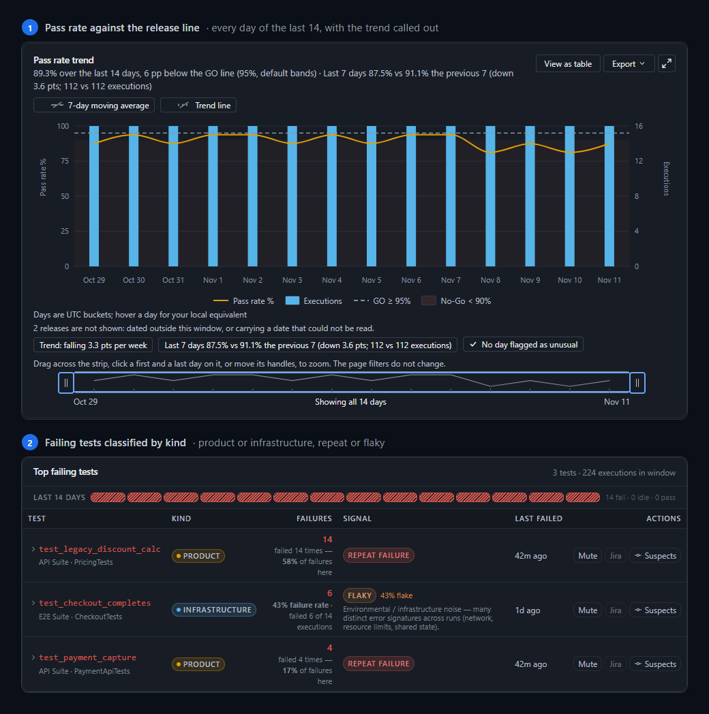

<!--
  DRAFT of the organisation profile README for github.com/test-intelligence.
  To publish it: create a public repository named `.github` in the
  test-intelligence organisation and commit this file as `profile/README.md`
  (without this comment). Nothing has been created or posted.
  The images load from the main repository's `main` branch, so publish this
  after the R4 pull request that adds docs/product/brand has merged.
  The maintainer block at the end is a placeholder for the owner to fill in.
-->
<p align="center">
  <picture>
    <source media="(prefers-color-scheme: dark)" srcset="https://raw.githubusercontent.com/test-intelligence/testlookup/main/docs/product/brand/wordmark-dark.svg">
    
  </picture>
</p>

<p align="center"><b>Know why your software tests fail. Know when to ship.</b></p>

**TestLookup** is free, open-source software test intelligence for software teams. It collects the test reports your CI already produces, groups failures by cause, scores flaky tests, and gives each release a GO or NO-GO recommendation with the evidence behind it. It runs on your own servers and works offline: AI analysis uses a local model unless an administrator allows a hosted one.

- **Repository:** [test-intelligence/testlookup](https://github.com/test-intelligence/testlookup) (Apache-2.0)
- **Website and docs:** [testlookup.app](https://testlookup.app) · [quick start](https://testlookup.app/docs/next/quickstart/) · [guided demo tours](https://testlookup.app/demo/) · [roadmap](https://testlookup.app/roadmap/)
- **Try it** (Docker with Compose v2; about 1 GB of images, demo data included):

  ```bash
  curl -fsSL https://raw.githubusercontent.com/test-intelligence/testlookup/main/install.sh | TL_PROFILE=demo bash
  ```

<p align="center">
  
</p>

## Get involved

- Pick up an issue labelled [good first issue](https://github.com/test-intelligence/testlookup/labels/good%20first%20issue) or [help wanted](https://github.com/test-intelligence/testlookup/labels/help%20wanted); [CONTRIBUTING.md](https://github.com/test-intelligence/testlookup/blob/main/CONTRIBUTING.md) explains the setup and the DCO sign-off.
- Ask questions and share ideas in [GitHub Discussions](https://github.com/test-intelligence/testlookup/discussions). <!-- Only once Discussions is enabled on the repository; until then, link SUPPORT.md instead. -->
- Report a vulnerability privately: [security policy](https://github.com/test-intelligence/testlookup/blob/main/SECURITY.md).

## Maintainer

<!--
  PLACEHOLDER for the owner: photo, name, one line on your role and focus,
  and the links you want shown (GitHub, LinkedIn, website). Nothing is
  filled in on your behalf.
-->
TestLookup is led by [@anandtopu](https://github.com/anandtopu). See [MAINTAINERS.md](https://github.com/test-intelligence/testlookup/blob/main/MAINTAINERS.md).
