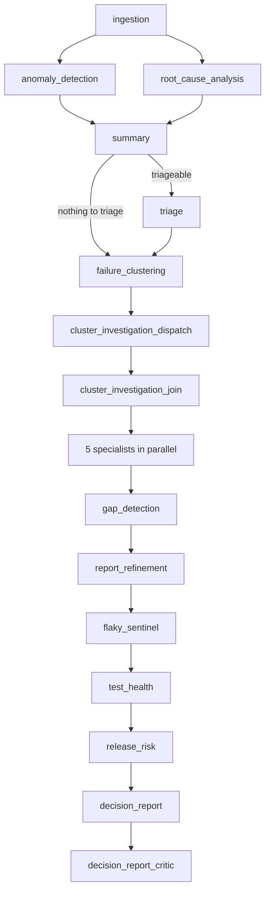
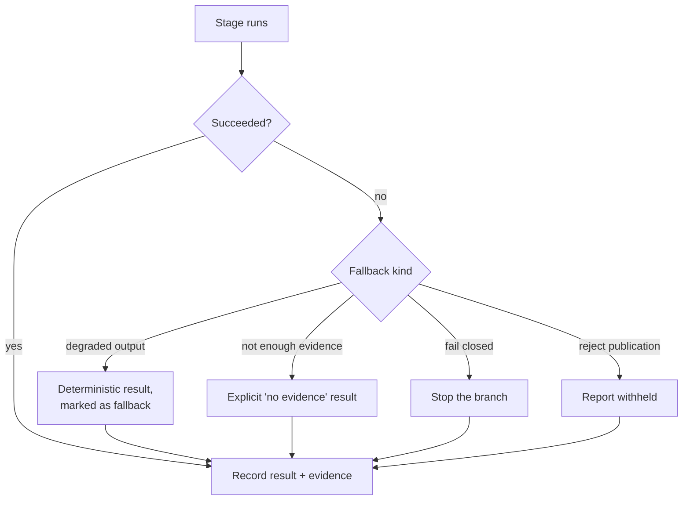

# AI agents and the pipeline

When a run finishes, TestLookup can run an **analysis pipeline**: a fixed sequence of stages, each performed by an agent. Some agents are pure arithmetic; some call a language model. This page says which is which, what each may read, and what happens when one fails.

> **Important.** Every agent's output is advisory. None of them changes your tests. Exactly one stage can change state outside its own record — `defect_commander` — and it is off by default. See [Permissions](#permissions-what-an-agent-may-do).

## Pipeline shape

There are four workflow types. The **deep** pipeline is the full one:

**In words:** ingestion validates what was stored. Anomaly detection and root-cause analysis run in parallel, then both feed the summary. From the summary the pipeline either triages (if any analysis is confident enough) or goes straight on to clustering. Clustering groups similar failures; a dispatch/join pair handles optional per-cluster child investigations. Five specialists then run **in parallel**, followed by gap detection and report refinement, the flaky and test-health stages, the release-risk score, the decision report, and finally a critic that verifies the report before it is published.

> **Note.** The five specialists are deliberately at the *same depth* in the graph. A predecessor at a different depth makes the join fire twice and re-runs everything downstream — a real incident this topology exists to prevent.

## The stages

| Stage | What it does | Permission | Fallback when it fails |
|---|---|---|---|
| `ingestion` | Validates persisted run facts, collects failed test IDs | read-only | fail closed |
| `anomaly_detection` | Compares pass rate to a branch-aware baseline | read-only | degraded output |
| `failure_clustering` | Groups similar failures by error text | read-only | one cluster per test |
| `cluster_investigation_dispatch` | Plans optional per-cluster child investigations | read-only | skip children, fail closed |
| `root_cause_analysis` | Per-test category and explanation | read-only | degraded output |
| `cluster_investigation_join` | Collects the child investigations | read-only | continue without children |
| `summary` | Run-level summary | read-only | degraded output |
| `triage` | Proposes/creates tickets for qualifying failures | **propose action** | degraded output |
| `contract_validation` | REST contract checks, scoped to the run | read-only | not enough evidence |
| `log_intelligence` | Log/trace evidence per cluster | read-only | not enough evidence |
| `regression_watchman` | Regression vs known-flake vs environment | read-only | degraded output |
| `change_ownership` | Baseline diff and cluster ownership | read-only | not enough evidence |
| `defect_commander` | Promotes a cluster to a defect | **mutating** | degraded output |
| `gap_detection` | Finds gaps in the draft report | read-only | degraded output |
| `report_refinement` | Improves the draft report | read-only | degraded output |
| `flaky_sentinel` | Investigates flaky-classified tests | read-only | degraded output |
| `test_health` | Scores automation-defect tests | read-only | degraded output |
| `release_risk` | Risk score and GO / CONDITIONAL_GO / NO_GO | read-only | deterministic release policy |
| `decision_report` | Assembles the decision report | read-only | degraded output |
| `decision_report_critic` | Verifies the report before publication | read-only | **reject publication** |

Twenty stages, in the order the deep pipeline plans them. A **standard** (offline)
run is much shorter — `ingestion`, `anomaly_detection`, `root_cause_analysis`,
`summary`, `triage` — so a run's **Evidence → Agent stages** list will show five stages, not
twenty, unless it was a deep run.

Not every deep stage runs on every install. Each optional stage has a feature flag, listed under **Settings › Feature flags** in the group **Agent stages (deep pipeline)**. The planner skips a stage whose flag is off for the project, and records why ("feature flag is off for this project"):

- `contract_validation`, `log_intelligence`, `regression_watchman` and `change_ownership` are read-only specialists, each with a flag of the same name. They are **on** for a new install. An install upgraded from an earlier version gets them **off** until an administrator switches them on (for `contract_validation` and `change_ownership`, a server environment setting that was already on keeps them on).
- `defect_commander` is marked **MUTATING**: it creates defects from high-confidence failure clusters, so its flag is **off** until an administrator turns it on. The agent must also be enabled in **Act** mode on **Settings › AI agents**; with only the flag on, the run says the agent is disabled.
- `gap_detection` and `report_refinement` run when the flag `aiq_gap_refinement` is on. Both are deterministic (no LLM, no network), and the flag is **on** for every install unless the server setting `AIQ_GAP_REFINEMENT_ENABLED` says otherwise. With them, the decision report carries an **Analysis coverage** line.
- `async_decision_report_supersession` is listed in the same group and is **off** unless its server setting is on.

A flag's **ON / OFF** button is the global switch. To run a stage for one project only, switch it on and list that project under the flag's **Edit**.

The feature-flag reference in the repository (`docs/operations/feature-flags.md`) lists each of these switches.

A separate **investigation** workflow runs a planner, five parallel hypothesis agents (infrastructure, commit, environment, known-flaky, regression) and a synthesis stage.

## Permissions: what an agent may do

The capability registry gives every stage a permission, and it is enforced as a property of the pipeline, not left to each agent's good behaviour:

- **`read_only`** — the overwhelming majority. Reads run data, writes only its own stage record and findings.
- **`propose_action`** — `triage`. Proposes work; ticket creation is gated by confidence thresholds and configuration.
- **`mutating`** — `defect_commander` alone. It writes a `Defect` row and, when Jira is configured, files a ticket. **It is off unless a project feature flag is explicitly enabled and the agent is enabled in Act mode** (Settings › AI agents; it starts disabled, in Shadow mode), and a missing flag evaluates to off.

> **Warning.** Turning on `defect_commander` means deep runs start creating defect records. Ticket filing additionally requires Jira to be enabled. See [Administration](/docs/administration).

## Rules, models and generated text

The router picks the first available of **ML → LLM → Rules**, and falls back rather than failing when a tier is unavailable:

- **ML** — used when a trained model exists for the project. When none is trained, the router records that and moves on.
- **LLM** — used when a provider is configured and reachable.
- **Rules** — deterministic pattern matching. Always available, and the floor under everything else.

The router records which mode was *requested*, which was *resolved*, and why — for example *"auto: no trained ML model; LLM provider configured and not known-unavailable"*. That trail is stored with the run, so you can always tell what produced a given answer.

> **AI output is advisory, not authoritative.** Every analysis carries a confidence score and provenance showing which engine produced it, and results below the configured confidence threshold are marked as needing human review. An LLM-written explanation is the least authoritative output in the system — read it as the first hypothesis a colleague would offer.

## What happens when a stage fails

**In words:** a stage that succeeds records its result and the evidence behind it. A stage that fails takes its declared fallback: most produce a deterministic degraded result marked as a fallback; the evidence-scoped specialists return an explicit *"not enough evidence"*; ingestion and cluster dispatch fail closed rather than continue on bad data; and the decision-report critic withholds publication rather than publish something it could not verify.

The important property: **a failed stage is recorded as failed.** It does not silently vanish, and an empty result is stated as an empty result rather than dressed up.

## Every stage records what it did

Each stage writes:

- a **stage row** with status and timing,
- **timeline events** when it starts and completes,
- a **decision trail** — the non-obvious branches it took and why, in its own words,
- an **agent contract** carrying whether a fallback was used, a confidence value, evidence references and a decision reason.

The pipeline is then **verified** against the plan it was given. The verifier checks, among other things, that every planned stage completed, that no unplanned stage ran, that routing rationales were persisted, and that any agent producing output also produced a contract. If that verification fails, the decision report is not published.

> **Note.** This is why you may see a run marked `partial`. It means the pipeline produced output but its own verification did not pass — deliberately visible rather than hidden.

## Budgets and configuration

Pipelines carry a budget (LLM calls, tokens, cost, seconds) allocated across stages that use a model. A stage that cannot reserve budget records a stop reason instead of running unbounded. Provider and model selection, and the per-project monthly LLM cost budget, are administrative — see [Settings and administration](/docs/administration#ai).

## Running a pipeline

The **standard** pipeline runs on its own when a run is finalised. You can also queue one, or a **deep** investigation, by hand. Both need the `QA_ENGINEER` role or above:

| Where | Standard pipeline | Deep investigation |
|---|---|---|
| A run's page, **⋯** menu | **Trigger pipeline** (opens the workflow picker) | **Deep investigation** |
| **Runs**, a row's action icons | **Re-trigger standard pipeline** | **Trigger deep investigation** |
| **Runs**, ticked rows | **Bulk trigger** | **Bulk deep** |
| **Runs**, **⋯** menu | **Trigger all failed (N)**, **Re-trigger all matching (N)** | **Deep all failed (N)** |
| **Pipeline runs** page | **Trigger pipeline**, or **Choose workflow** next to it | — |

A trigger that does not choose a workflow runs the project's default for that kind of pipeline: the built-in workflow, unless a QA lead made a published fork the default (see [Project default workflow](#project-default-workflow)). **Choose workflow** and the run page's **Trigger pipeline** let you pick one for this run. The bulk actions on **Runs** are tracked as one job with its own progress panel (see [Bulk jobs](/docs/runs#bulk-jobs)).

If a pipeline is already queued or running for that run, a new request is not started twice: a bulk request counts such runs as already running instead of queuing them.

The deep-investigation buttons are offered only while **Deep Investigation** is ticked under **Settings › AI** and the analysis mode is not **Rules**. Otherwise the run's page, its **Analysis** tab and the **Deep Investigation** page show a note saying why instead (**Runs** keeps its deep actions; the server refuses them with the same reason). When a run's last deep investigation failed, the **Deep Investigation** page and the run's **Analysis** tab offer **Retry from last successful stage**: it resumes that investigation, keeping the stages it completed, or starts a new one when the analysis configuration changed since it ran.

## Pipeline runs

**Pipeline runs** (`/agents`, listed under **AI** in the settings index) lists every AI pipeline run in the projects you can see, newest first. Pick a run under **Test suite & build** to see only its pipelines and to enable **Trigger pipeline**. The badge next to it shows the analysis mode in use (**LLM Mode**, **ML Mode**, **Rules Mode** or **Auto Mode**).

Each pipeline shows its type, run, suite, start time, duration and status (**IN PROGRESS**, **COMPLETED**, **FAILED** or **PASSED**), plus **DEGRADED** when a stage fell back, **awaiting review** when its report is waiting for a human decision, and **retrying** while it retries. Select one to read its **AI Report** (**View AI report**), its **Agent stages** (each stage, its timing, the compute graph and the raw stage records) and its **Workflow Progress**.

With the `QA_ENGINEER` role or above you can act on a pipeline from its row:

- **Retry** is offered on a **FAILED** pipeline and on a **COMPLETED** one marked **DEGRADED**. The server decides what happens. If the analysis configuration is the same as when the pipeline started, the pipeline **resumes** and keeps the stages it already completed (the row reads "Resumed (attempt 2/5)"). If the configuration changed since then (for example the confidence threshold or the timeout under **Settings › AI**), it **starts a new run** instead. A pipeline that was rejected in review, finished successfully, or reached its attempt limit is not retried: the row says why and offers **Start a new run**.
- **Stop** is offered while a pipeline is in progress, and asks you to confirm. A queued pipeline stops at once. A running one shows **stopping** and ends at its next stage boundary. A stopped pipeline ends **FAILED** and is not resumed: its row offers **Start a new run** instead of **Retry**.

Both actions are recorded in the project's activity ("AI analysis for … was retried", "… was cancelled").

The same report and stages for one run are on that run's **Evidence** tab. Anyone with access to the project can read this page.

Above the AI report, one line names the workflow the pipeline ran and why: `Workflow wf.my-fork@3 · project default`, `· built-in`, `· chosen for this run`, or `· built-in — the default was unavailable` (hover for the reason). Pipelines from before this line existed show none.

## Audit and Compare

Open a pipeline's **Agent stages** (here, or on a run's **Evidence** tab) and the graph frame has three tabs: **Graph** (the default, see [The graph of any pipeline](#the-graph-of-any-pipeline)), **Audit** and **Compare**. The tab is kept in the address (`?ptab=audit`), so a reload or a shared link reopens it; the run page's own tab is left alone.

**Audit** is the pipeline's replay record. Its tab label already says `Audit · replayable ✓` or `Audit · N gaps`. Inside: whether the pipeline is replayable, the analysis mode it asked for and the one it resolved to, its final-state checksum, and a table of every stage with its input and output checksums, whether a checkpoint was saved and restored, and how many decisions it logged. Below the table come the route decisions, the memory references the pipeline read, and its events (a count per type, then the newest 200 with their details). When the pipeline is not fully replayable, an **Audit gaps** panel comes first and lists what is missing: start or terminal events, replay checksums, checkpoints, or the final-state checksum. Older pipelines often have gaps; they are facts about the record, not an error.

**Compare** puts this pipeline beside another pipeline of the same run. **Compare with** lists that run's other pipelines and starts on the one this pipeline was re-run from, otherwise the newest older pipeline of the same type. For each stage the table shows status, duration, tokens, cost, fallback, confidence and output as `before → after`, marks the cells that changed, and says when a stage ran in only one of the two. Above it: `Output identical`, `Output changed in N stages`, or `Output unknown` when no stage recorded a checksum, and each side's workflow, resolved analysis mode, release verdict and totals. A value a pipeline did not report is shown as `—`, never as zero. Only pipelines of one project can be compared.

## The graph of any pipeline

**Graph** draws the stages the pipeline really has. The standard pipeline (`offline@1`) keeps its hand-drawn compute canvas. Every other shape — a deep investigation with its specialists side by side, the live pipeline, an Investigator run (a plan, five hypotheses, a synthesis), a single invoked agent, a published fork, and a deep investigation's child investigations — is laid out from the dependencies the pipeline recorded when it started: one node per stage (its latest attempt, marked `attempt N` when it ran more than once), coloured by status, left to right in dependency order, with a loop back drawn dashed. Select a node to see its tokens and cost beside the graph. When a pipeline has more stages than the graph draws, a line above it says how many are left out; a dependency on a stage the pipeline does not have is listed under the graph rather than drawn. If the graph cannot be loaded, the plain list of stages is shown instead.

## The workflow editor

**Pipeline runs → Workflow editor** (`/agents/workflows`) holds the versioned definitions behind the pipelines. The three built-in workflows (`offline` — the standard pipeline, `deep` and `live`) are read-only; to change one, you fork it.

- **Fork workflow** — give a **New workflow ID** and a **Fork name**, then **Create fork**. Forks start as drafts.
- Edit the **Definition JSON** (steps, edges, loops, retry and review policies, deadline) and **Save draft**. Saving a published version creates the next version as a draft; published versions are never edited in place.
- **Validate** checks the definition; **Graph preview** draws its topology.
- **Run evaluation** replays recent runs (20 by default) through the draft and compares the result with the published version.
- **Publish** makes the draft the version runs use. Publishing re-evaluates the draft on 100 replayed runs and refuses a measured regression unless you tick **Accept the measured regression for this publication** and give a reason.
- **Delete draft** removes a fork's latest version while it is still a draft, after you confirm. Published versions are kept.

Anyone can open the editor and inspect definitions and validation; forking, editing, evaluating, publishing, deleting a draft and choosing the project default need the `QA_LEAD` role. Only **published** versions ever execute. A fork runs when it is the project's default for its base (see [Project default workflow](#project-default-workflow)) or when someone picks it for one run with **Choose workflow** or a run's **⋯ › Trigger pipeline**; an API caller can also name it (`workflow_id`) in `POST /api/v1/agents/pipelines/trigger`.

## Project default workflow

A published fork can be the workflow a project's new runs use. In the workflow editor, a QA lead selects the fork and turns on **Use for new offline runs** (**Use for new deep runs** for a fork of `deep`). When the fork's steps call a model, the editor says so beside the switch (`Every new run calls a model in N stages: …`): every automatic analysis then makes those model calls. The default follows the fork's newest published version, so publishing version 2 makes version 2 the default without touching the switch. Turning the switch off returns new runs to the built-in workflow. Other roles see `Used for new offline runs` on the fork that is the default, and a built-in workflow says which fork, if any, is used instead. Setting and clearing a default are recorded in the project's activity.

Every trigger that does not choose a workflow uses the default for its base: the automatic analysis after each ingest, **Trigger pipeline** on **Pipeline runs**, the bulk actions on **Runs**, and a deep investigation. To run something else once, use **Choose workflow** (next to **Trigger pipeline** on **Pipeline runs**) or a run's **⋯ › Trigger pipeline**: pick the project default, a built-in workflow or a published fork, then **Queue pipeline**. Drafts are never listed. A retry keeps the workflow its pipeline started with.

Only a fork of the same project can be its default, and only for its own base: a fork of `deep` can be the deep default only. The editor refuses a fork that no longer passes validation. If a default cannot be used when a run starts (its version is gone, it is no longer built on that base, or it no longer passes validation), the run uses the built-in workflow and records why, so its workflow line reads `built-in — the default was unavailable`. A run is never left unstarted because of its default.

## The Investigator and the Fixer

Two further agents can act on a project's failures beyond the analysis pipeline: the **Investigator** (reasons about clusters of failures) and the **Fixer** (proposes validated fixes for flaky tests as draft pull requests). Their policies, autonomy levels and budgets are per project under **Admin → AI → AI agents**, and what they did is under **Agent activity**; see [Settings and administration](/docs/administration#ai).

## Human-in-the-loop

- Every AI-produced category or explanation can be **corrected**; the correction is stored alongside the original.
- Decision reports carry their evidence, so a reviewer can check the reasoning rather than the wording.
- Every AI report is a **review request**: a QA lead can accept or reject it from the Inbox's **Approvals** tab, and the report carries a banner saying whether it is a draft, accepted, rejected or superseded. An administrator can make review mandatory before a report is distributed. See [Your inbox and approvals](/docs/inbox#approvals).
- Nothing an agent produces is treated as final by the release gate — see [Releases and gates](/docs/releases).

## Related

- [How decisions are made](/docs/decisions) — the decision tables
- [Investigating failures](/docs/failure-analysis)
- [Architecture](/docs/architecture) — where the workers and queues sit
