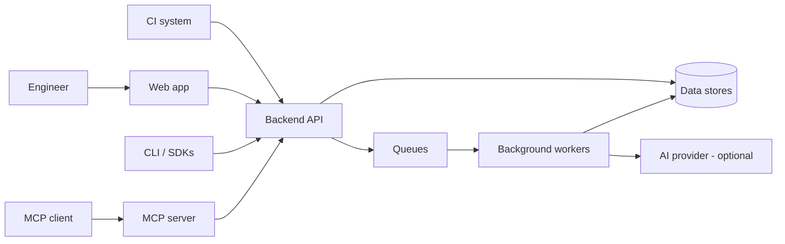
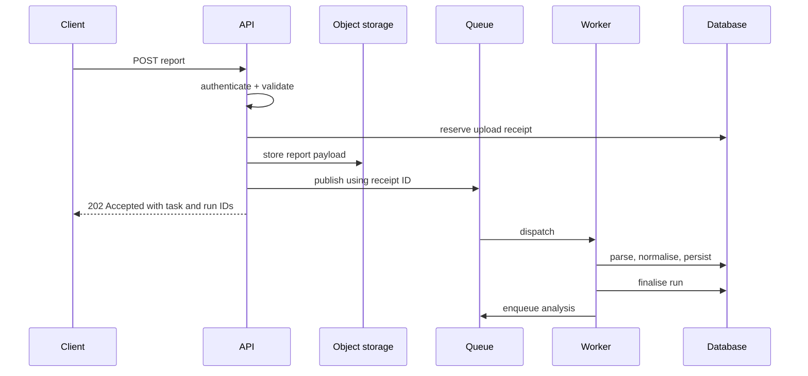
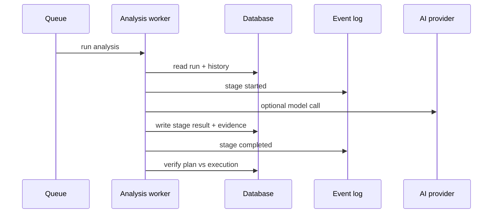
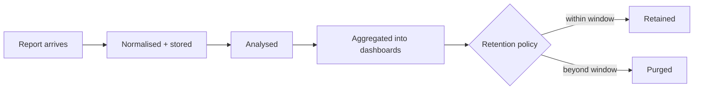

# Architecture

Enough of the shape to reason about where something went wrong.

## System context

**In words:** people use the web app; CI systems, the CLI and SDKs use the backend API directly; MCP clients reach it through the MCP server. The API reads and writes the data stores and enqueues background work. Workers do the slow parts — parsing, analysis — and may call an AI provider when one is configured.

## Components

| Component | Role |
|---|---|
| **Web app** | React single-page app; the UI you use |
| **Backend API** | HTTP API, authentication, authorisation, request handling |
| **Relational database** | Runs, tests, projects, users, defects, audit |
| **Document store** | Pipeline event logs and immutable audit streams |
| **Cache / broker** | Queue broker, feature-flag cache, live event streams |
| **Object storage** | Reports, packs, uploaded documents |
| **Vector store** *(optional)* | Semantic search |
| **AI provider** *(optional)* | Hosted or local model access |
| **Workers** | Ingestion parsing, analysis pipeline, scheduled sweeps |
| **MCP server** | Model-context-protocol access for AI clients |

> **Note.** The vector store and AI provider are optional. Without them, semantic search falls back to keyword matching and analysis falls back to rules — the product works, with fewer capabilities.

## Ingestion path

**In words:** the API validates the request, records an upload receipt, and prepares the payload for a worker. An accepted response supplies the task and run IDs. The worker parses and persists the results, finalizes the run, and queues analysis when enabled. Follow the original receipt if publication confirmation is pending. [Upload a report](/docs/ingestion#upload-a-report-from-the-app).

## Analysis path

**In words:** a worker reads the run and its history, and for each stage records a start event, optionally calls a model, writes the result with its evidence, and records completion. At the end the pipeline verifies what executed against the plan it was given.

## Queues

The parent workers consume the critical, ingestion, AI-analysis, and default queues. Ingestion shards distribute ingestion work. A dedicated worker consumes `agent_children` for child investigations.

> **Tip.** "Analysis is slow" and "ingestion is slow" are different problems on different lanes. Knowing which is queued narrows it quickly.

## Data lifecycle

**In words:** a report is normalised and stored, analysed, and rolled into aggregates. Retention policy decides how long the underlying records are kept; purging is an administrative setting.

## Deployment

TestLookup runs the web app, API, workers, and data stores in containers. The deployment routes browser and API requests to the appropriate services. Operators scrape metrics through a private monitoring path and can enable searchable operational logs and traces. Use the **Help** menu to identify the frontend build and `/health/version` on the backend to identify the API build.

> **Note.** The API reference (Swagger) is at **`/api-docs`**. This page you are reading is at `/docs`, served by the web app.

## Related

- [AI agents and the pipeline](/docs/ai-agents)
- [Administration](/docs/administration)
