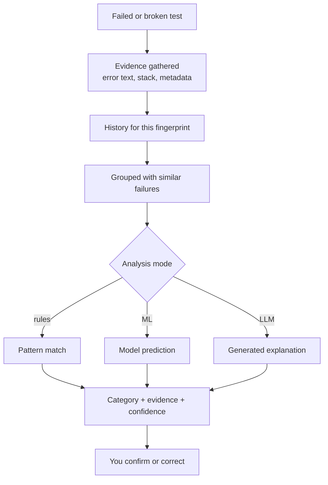

# Investigating failures

What happens to a failed test between ingestion and the explanation you read, the three pages under **Failures** in the sidebar (**Failures**, **Defects** and **Root cause (AI)**), and how to correct the result when it is wrong.

## The path a failure takes

**In words:** a failed or broken execution has its evidence gathered — error text, stack trace, metadata — then its history is looked up by fingerprint and it is grouped with similar failures. The router picks rules, a trained model, or a language model, and the result is presented as a category with its evidence and a confidence indication. You confirm or correct it, and that judgement is recorded.

## What you see on a failure

Open a failed test from a run (see [Runs and run detail](/docs/runs#one-test-result)):

- **Error and stack trace** — the evidence as recorded. Read this first.
- **Category** — what kind of problem this looks like (for example product bug, automation defect, infrastructure, test data, flaky).
- **AI root cause** — **Analyse Root Cause** produces a suggested root cause, with a confidence, actions for your role and all recommended actions.
- **History** — this test's recent results across runs, and for step-based tests, which step flips between pass and fail.

> **Important.** The suggested root cause is generated text. It is the first hypothesis a colleague would offer, not a finding. Check it against the evidence.

## Separating what you are looking at

| On screen | Kind | Weight |
|---|---|---|
| Error message, stack trace | Observed evidence | Fact |
| Failure counts, pass rate | Deterministic | Reproducible |
| Category from rules | Deterministic | Reproducible |
| Category from a model | Model output | A signal |
| Root-cause narrative | Generative | Confirm before acting |
| Your correction | Human | Authoritative |

## The Failures page

**Failures** (`/failures`, titled **Failure Analysis**) is the project-wide view of what is failing in the window (24h to 90d), optionally limited to one suite.

- **The verdict banner** sums up the window: **Repeat failure**, **Flaky**, **First-time failure**, **Recovering**, **Stable** or **Pending**, with stability, pass rate and the latest failing suite. **Compare to previous window** shows the change against the window before.
- **KPIs**: **Repeat failures**, **Flaky tests**, **Uncategorized**, **Total executions** and **Median time to fix**: the median time from a test's first failure to its next pass, over the window, with how many tests were fixed (`1.8 d`, `23 fixed`; hover for the rule). Tests flagged flaky (an open quarantine, or a human **Flaky test** triage) and tests that failed and recovered three or more times in the window are left out; a failure already open when the window starts counts from its first failure inside it. With fewer than 5 fixes in the window the tile reads **Not measured** with the reason. In **How this score is computed**, **Time to fix** scores that median (0 hours → 100, a week or more → 0), or reads **—** when it is not measured and the score uses the other three parts.
- **Top failing tests**: each test's kind, failure count, signal and when it last failed. With one project selected, the arrow before a test's name opens its **latest failure**: when and in which build it happened, the first line of its error (or **No message recorded**), the first 20 lines of its stack trace (secrets are redacted), its **Owner** (`Priya Nair · assignee`, a team `· ownership rule`, `· component map` or `· owner label`, or **Unassigned**) and **Open in run**, which opens that test in that run. In **All Projects** the row reads **Select a project to see failure detail**. Each row has three actions:
  - **Mute** — opens a form under the row that proposes the test for quarantine, with a required reason. A QA lead decides the proposal under **Flaky tests → Proposed**. Needs quarantine to be on for the project; see [Flaky tests](/docs/flaky#quarantine-on-the-flaky-tests-page).
  - **Jira** — opens **Create Jira issue** under the row (see [Promoting to a defect](#promoting-to-a-defect)).
  - **Suspects** — opens **Who / what changed** under the row: the commits that landed since the last green run, ranked by how much their changed files overlap with the failing test. They are suspects to check, never a verdict. Needs the run to carry a commit range.
- **Tabs**: **Groups** (failure groups, and **Systemic flake clusters** — flaky failures that share a cause), **By suite** (drill down from suite to status to test to execution), **Scatter** (test duration against failure rate) and **Categories** (the split by failure category).
- **⋯ menu**: **Export CSV**; **Notify suite owner**; and **Classify uncategorised failures**, offered when half or more of the window's failures have no category, which applies one category you choose to all of them (pick a single suite first).
- **Open triage queue** opens Runs for the same window.

A test you marked as **Flaky test** in your Inbox shows a **Flagged** pill here.

In **All Projects**, the actions ask you to pick a project first.

## Correcting a classification

When a category is wrong, record the right one:

- On a test result, **Correct** (next to the AI result). On the Failures page's **Categories** tab, when half or more of the failures are uncategorised, **Correct the classification** opens the same form under the page header.
- In **Correct classification**, pick **Flaky**, **Product Bug**, **Infrastructure**, **Test Data** or **Automation Defect**, add an optional comment, and **Record correction**.
- **Confirm** on a result records that the analysis was right.

Corrections are stored alongside the original rather than overwriting it, so the trail shows both what the system said and what you decided. They also stick: the next time the same test is analysed, your correction is applied before the rules or models run, and the wrong answer is removed from the cache of similar failures. Recording a correction is worth doing even when the category is close but wrong — a human judgement on a failure is the most reliable signal in the system, and it is what the ML classifier learns from.

Required role: `QA_ENGINEER` or higher.

## Classification hints

A correction fixes one test. A **classification hint** classifies every new failure that matches it: on **Failures → Categories**, a QA lead opens **Classification hints** and writes rules of the form "**Error message** / **Test name** / **Suite** / **Class** contains `text` → category" (case-insensitive; plain text, not a pattern language; 3 to 200 characters, up to 50 hints per project).

- While you type, the preview says how many recent failures the hint would match (`7 of the last 200 failures match`) and shows a few of them.
- From the next analysis on, a failure a hint matches is classified by that hint before the rules, the ML classifier or a language model runs. Its result says **project hint**, and the run's decision trail reads `Matched project hint (set by Priya Nair): error message contains "ECONNREFUSED" → Infrastructure`. A human correction of the same test still wins over a hint.
- When several hints match, the oldest one is used. A hint can be disabled without deleting it; **Delete** asks in the hint's own row before it removes it.
- Existing analyses are not changed; re-run the analysis of a run to apply new hints to it.

Adding, changing and deleting hints is recorded in the activity feed. Required role to edit: `QA_LEAD` or higher; other roles do not see the button.

## Promoting to a defect

A failure becomes a tracked **defect** in one of three ways (all need `QA_ENGINEER` or higher):

1. **From a cluster** — on a run's **Analysis** tab, **File defect** on a cluster opens **Promote to Defect**: title, severity (pre-filled from the cluster's risk: **CRITICAL** at 70 or above, **HIGH** at 50, **MEDIUM** at 30, otherwise **LOW**), component, owner team, labels, description, and an optional Jira project key (leave it blank for a defect recorded only in TestLookup). The cluster's evidence travels with the defect.
2. **From a failing test** — **Jira** on the Failures page, or **File Jira** on a quarantined test, opens **Create Jira issue**. The summary and description are filled in by the server (test or cluster, failure message, stack trace, first and last seen, failing-run count, branch and build, a link back, and the AI's suggested root cause clearly labelled as AI). Choose the **Jira project**, **Issue type** and an optional **Comment**, then **Create issue**. Nothing is filed until you confirm.
3. **By hand** — **Defects → New defect**: title, severity (**P0 — Blocker** to **P3 — Low**), failure category, component, and optionally the test, suite, the release it **affects** (**Affects release**; a defect filed against a release that has already shipped counts toward the escape rate), an existing Jira ticket URL and a description.

A promotion that names a Jira project key, is **CRITICAL** or **HIGH**, or has low AI confidence comes back as **Defect created — awaiting approval**. A QA lead decides it in [Inbox › Approvals](/docs/inbox#defects) (source **Defects**): **Approve** makes it effective and, when a Jira project key was given and Jira is reachable, files the ticket on that defect; **Reject** (with a reason) closes it as **Invalid**.

If an open defect is already linked to Jira for the same failure, **Create Jira issue** does not file a duplicate: the button reads **Note recurrence**, and the existing issue gets a "recurred" comment instead. With no Jira, the same form can **Deliver via** **Webhook event**, which sends the filled-in issue to your own system as an outbound webhook (an administrator sets that up).

Jira ticket creation needs Jira to be configured and offline mode to be off. A defect can always exist in TestLookup without an external ticket.

> **Warning.** Automatic promotion during the AI pipeline (`defect_commander`) is **off by default** and gated by a project feature flag. Manual promotion is always available. See [Settings and administration](/docs/administration#feature-flags).

## Defects

**Failures → Defects** (`/defects`) is the project's defect queue.

- **The verdict banner**: **Release blocked** (any P0 open), **Queue healthy**, **At risk** or **Pending**, with how many defects have no Jira ticket, the oldest open P0 (or, with none open, **Net this week**: the last seven days' opened minus closed) and the queue health.
- **KPIs**: **Open defects**, **P0 / P1 open** and **Time to resolve**, each with a sparkline over the window (**7d**, **14d**, **30d** or **90d** in the header; hover a point for that day's opened and closed defects), **Escape rate** and **Oldest open P0**. The values count every defect in scope, not only the rows the table loads.
- **Escape rate** is the share of the defects reported in the window that were filed after a release they affect had shipped. With fewer than 5 such defects it reads **Not measured** and says why, never 0 %. Its hover adds the incidents and rollbacks marked on releases in the window.
- **All defects**: filter by status (**All**, **Open**, **In progress**, **Resolved**, **Closed**; **Closed** holds the **Invalid** ones) or search titles, Jira keys and owners. Severity shows as **P0**–**P3** (critical to low). **Owner** is the assigned person (with their team), else the defect's team, else the team the project's ownership rules give it (marked *from ownership rules*, *from the component map* or *from the test's owner label*), else **Unassigned**. **Open** goes to the Jira issue. A defect approved while Jira was off reads **not filed (offline)** in the Jira column.
- **Only this release** (in the header, with one release picked in the top bar) narrows the table, the tiles and the sparklines to the defects that affect that release, by the release gate's own rule: the releases a defect says it affects, else the one it was found in. The banner then reads **Affecting {release}**. The suite select narrows to defects whose failing test ran in that suite. Both are kept in the URL and in saved views.
- **Jira status** is mirrored from Jira about every 15 minutes. **closed in Jira but still failing** marks a defect whose Jira issue is done while the same test kept failing in the last 7 days.
- Tabs: **Where defects live** (by component) and **Jira bridge** (how the defects map to Jira).
- **How queue health is computed** weighs four dimensions: P0 throughput, Jira coverage, fix velocity and **Ownership** (20 %: open defects with an assignee or a team).

### Triaging a defect

QA engineers, QA leads and administrators get a **⋯ Defect actions** menu on each row (viewers and testers do not):

- **Change status…** — **Open**, **In progress**, **Resolved** or **Invalid**, with an optional note for the activity log. A defect **In progress** still blocks the release gate. Re-opening a defect whose test already has an open one is refused and names it.
- **Assign…** — a person of the project and a **Team**. Service accounts and deactivated users are not offered.
- **Link Jira issue…** — an issue key such as `ABC-123`; TestLookup builds the link from the configured Jira domain. Once linked the item reads **Change Jira issue…** and offers **Remove link**.

Every change is recorded in the [activity log](/docs/administration#activity-log) and the row updates in place. While offline mode is on (the default) or Jira is not set up, all three still work: a key is saved without a check ("saved locally"), and nothing is sent to Jira. With Jira reachable, a key is checked against Jira before it is saved, and changing the status of a linked defect moves its Jira issue to the matching status (To Do, In Progress or Done); if Jira refuses the move, the status is still saved and a second message says so.

## Root cause (AI): deep investigation

**Failures → Root cause (AI)** (`/deep-investigate`, titled **Deep Investigation**) runs a deeper, AI-driven analysis of one run's failures: it clusters them semantically, investigates each cluster against the available evidence sources, and records a finding per cluster.

1. The page picks the newest run; choose another from **Recent runs**, or narrow by suite.
2. Read the verdict: **Ready to investigate**, **Nothing to investigate**, **No evidence sources**, **Investigation running**, **Last run failed** or **Awaiting runs**, with how many failures are eligible.
3. **Run Deep Analysis** (or **Run on all N failures**, or **Run on selection** in the run configuration) starts it. It needs the `QA_ENGINEER` role, and analysis in **Auto**, **LLM** or **ML** mode (not **Rules**). The buttons appear only when the server would accept the run: a configured **Auto** that resolves to rules shows the reason in their place, never a button that fails when clicked.
4. **Proposed clusters** fills in as it works: for each cluster, the failure count, a likely severity, and when an AI finding exists, the suggested root cause with its confidence and where it came from (**the deep-analysis pipeline**, or **seeded demo data** on a demo install). A cluster without one says "No AI finding recorded for this cluster yet."

The page also shows five KPIs: **Eligible** (eligible failures), **Clusters** (the last analysis's clusters and their average confidence), **Analyzed** (the last analysis), **Confidence** (average cluster confidence) and **Spend MTD**. Hover a label to see its full name.

### Pre-scan

The **Pre-scan** facet groups the run's failing (failed and broken) results by error signature, before any AI runs: the same normalised first line of the error that the Runs page's signatures and the failure groups use. It reads **N groups** with the number of failing results. When an earlier deep analysis clustered this run, each group also names the cluster holding most of its failures (**clusters shown**); otherwise the page says it grouped by error signature only. The pre-scan calls no model and no embedding store, and changes nothing. A run without failing results shows **—** (no failing results), not "0 groups".

### Recent and investigated runs

**Recent runs** lists the six newest runs (the page's run picker). A run that was deep-investigated fills its **Clusters**, **Findings**, **Avg conf**, **Cost** and **Status** from its latest deep investigation; the others show **—**. **Investigated runs · N** switches the table to every investigated run of the project, newest first, with **Prev** / **Next**. Cost is the sum of the stages that reported one: an investigation whose stages reported none shows **—**, not $0.00. The history is per project, so with **All Projects** and no run picked the chip is not shown.

### Cost & time

**Cost & time** estimates a run from the project's last 20 completed deep investigations: the median time of each stage, with the Root Cause stage scaled by the number of failures it will analyse, and the four slowest stages listed. It always names its sample (**estimate from N past runs**); before the first completed investigation it says **Not measured yet** instead of a number. A local model (Ollama or another self-hosted endpoint) costs **$0.00 · local model — no charge**. A cloud model is priced from the built-in price table (its date is shown) or the deployment's `LLM_PRICE_OVERRIDES`; a model with no known price shows **—** and says that the cost cannot be estimated, never a quiet $0.00. Reading the estimate calls no model.

### Run configuration

QA engineers and above see **Run configuration** above Proposed clusters; other roles see the pre-scan groups only.

- Tick pre-scan groups to analyse only their failures (at most 500 failures in one run).
- **Model tier**: the project's tier for the Root Cause agent, or a cheaper one (**deterministic** calls no model).
- **Failures analysed at most**: up to the project's cap.
- **Evidence sources**: fewer of the Root Cause agent's evidence tools, when the project's agent settings allow narrowing.

**Estimate** re-reads Cost & time for that configuration without starting anything; **Run on selection** starts the run. A configuration can only tighten the project's agent settings (**Settings › Agents**): a looser value is refused with the reasons, before anything is queued. The configuration is fixed when the run starts and a retry keeps it; if a QA lead tightened the project's settings in between, the stricter project value wins and the run says so in its record. Starting a run while one of the same run is in progress returns that one ("Deep investigation already in progress") instead of a second. Every start is recorded in the [activity log](/docs/administration#activity-log).

### LLM and offline mode

A deep investigation needs **Deep Investigation** turned on in **Settings › AI** and an analysis mode that resolves to a model (**LLM**, or **Auto** with a reachable model), not **Rules**. With offline mode on (the default) only a local model can run it: a tier whose only endpoint is a cloud model shows "No model endpoint is allowed for tier …" in Cost & time. The pre-scan, the history and the estimate need neither a model nor the embedding store, so they work on every install.

The same clusters, for one run, are on that run's **Analysis** tab (**Analyze failures**), which is where old `/deep-investigate/<run id>` links open. To turn a cluster into a defect, use **File defect** there.

## Limitations

- **Clusters group by resemblance.** Two identical messages can have different causes.
- **Rules are patterns.** A novel failure mode falls outside them.
- **Model output reflects its training.** A project unlike the training data gets weaker predictions.
- **Generated text is fluent regardless of evidence quality.** Fluency is not confidence.

## Related

- [Your inbox and approvals](/docs/inbox) — failures assigned to you
- [Flaky tests](/docs/flaky) — for tests that flip rather than fail
- [How decisions are made](/docs/decisions)
- [Search and discovery](/docs/search)
