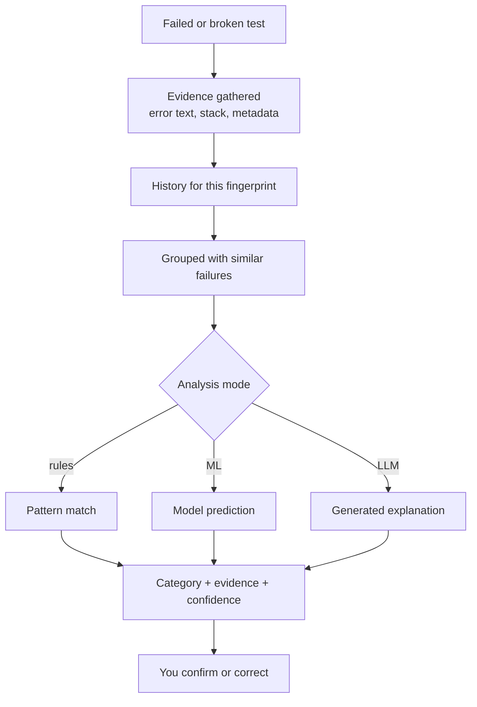

# Investigating failures

What happens to a failed test between ingestion and the explanation you read, the three pages under **Failures** in the sidebar (**Failures**, **Defects** and **Root cause (AI)**), and how to correct the result when it is wrong.

## The path a failure takes

**In words:** a failed or broken execution has its evidence gathered — error text, stack trace, metadata — then its history is looked up by fingerprint and it is grouped with similar failures. The router picks rules, a trained model, or a language model, and the result is presented as a category with its evidence and a confidence indication. You confirm or correct it, and that judgement is recorded.

## What you see on a failure

Open a failed test from a run (see [Runs and run detail](/docs/runs#one-test-result)):

- **Error and stack trace** — the evidence as recorded. Read this first.
- **Category** — what kind of problem this looks like (for example product bug, automation defect, infrastructure, test data, flaky).
- **AI root cause** — **Analyse Root Cause** produces a suggested root cause, with a confidence, actions for your role and all recommended actions.
- **History** — this test's recent results across runs, and for step-based tests, which step flips between pass and fail.

> **Important.** The suggested root cause is generated text. It is the first hypothesis a colleague would offer, not a finding. Check it against the evidence.

## Separating what you are looking at

| On screen | Kind | Weight |
|---|---|---|
| Error message, stack trace | Observed evidence | Fact |
| Failure counts, pass rate | Deterministic | Reproducible |
| Category from rules | Deterministic | Reproducible |
| Category from a model | Model output | A signal |
| Root-cause narrative | Generative | Confirm before acting |
| Your correction | Human | Authoritative |

## The Failures page

**Failures** (`/failures`, titled **Failure Analysis**) is the project-wide view of what is failing in the window (24h to 90d), optionally limited to one suite.

- **The verdict banner** sums up the window: **Repeat failure**, **Flaky**, **First-time failure**, **Recovering**, **Stable** or **Pending**, with stability, pass rate and the latest failing suite. **Compare to previous window** shows the change against the window before.
- **KPIs**: **Repeat failures**, **Flaky tests**, **Uncategorized** and **Total executions**.
- **Top failing tests**: each test's kind, failure count, signal and when it last failed, with three actions:
  - **Mute** — proposes the test for quarantine, with a required reason. A QA lead decides the proposal under **Flaky tests → Proposed**. Needs quarantine to be on for the project; see [Flaky tests](/docs/flaky#quarantine-on-the-flaky-tests-page).
  - **Jira** — opens **Create Jira issue** (see [Promoting to a defect](#promoting-to-a-defect)).
  - **Suspects** — opens **Who / what changed**: the commits that landed since the last green run, ranked by how much their changed files overlap with the failing test. They are suspects to check, never a verdict. Needs the run to carry a commit range.
- **Tabs**: **Groups** (failure groups, and **Systemic flake clusters** — flaky failures that share a cause), **By suite** (drill down from suite to status to test to execution), **Scatter** (test duration against failure rate) and **Categories** (the split by failure category).
- **⋯ menu**: **Export CSV**; **Notify suite owner**; and **Classify uncategorised failures**, offered when half or more of the window's failures have no category, which applies one category you choose to all of them (pick a single suite first).
- **Open triage queue** opens Runs for the same window.

A test you marked as **Flaky test** in your Inbox shows a **Flagged** pill here.

In **All Projects**, the actions ask you to pick a project first.

## Correcting a classification

When a category is wrong, record the right one:

- On a test result, **Correct** (next to the AI result). On the Failures page's **Categories** tab, when half or more of the failures are uncategorised, **Correct the classification** offers the same dialog.
- In **Correct classification**, pick **Flaky**, **Product Bug**, **Infrastructure**, **Test Data** or **Automation Defect**, add an optional comment, and **Record correction**.
- **Confirm** on a result records that the analysis was right.

Corrections are stored alongside the original rather than overwriting it, so the trail shows both what the system said and what you decided. They also stick: the next time the same test is analysed, your correction is applied before the rules or models run, and the wrong answer is removed from the cache of similar failures. Recording a correction is worth doing even when the category is close but wrong — a human judgement on a failure is the most reliable signal in the system, and it is what the ML classifier learns from.

Required role: `QA_ENGINEER` or higher.

## Promoting to a defect

A failure becomes a tracked **defect** in one of three ways (all need `QA_ENGINEER` or higher):

1. **From a cluster** — on a run's **Analysis** tab, **File defect** on a cluster opens **Promote to Defect**: title, severity (pre-filled from the cluster's risk: **CRITICAL** at 70 or above, **HIGH** at 50, **MEDIUM** at 30, otherwise **LOW**), component, owner team, labels, description, and an optional Jira project key (leave it blank for a defect recorded only in TestLookup). The cluster's evidence travels with the defect.
2. **From a failing test** — **Jira** on the Failures page, or **File Jira** on a quarantined test, opens **Create Jira issue**. The summary and description are filled in by the server (test or cluster, failure message, stack trace, first and last seen, failing-run count, branch and build, a link back, and the AI's suggested root cause clearly labelled as AI). Choose the **Jira project**, **Issue type** and an optional **Comment**, then **Create issue**. Nothing is filed until you confirm.
3. **By hand** — **Defects → New defect**: title, severity (**P0 — Blocker** to **P3 — Low**), failure category, component, and optionally the test, suite, an existing Jira ticket URL and a description.

If an open defect is already linked to Jira for the same failure, **Create Jira issue** does not file a duplicate: the button reads **Note recurrence**, and the existing issue gets a "recurred" comment instead. With no Jira, the same dialog can **Deliver via** **Webhook event**, which sends the filled-in issue to your own system as an outbound webhook (an administrator sets that up).

Jira ticket creation needs Jira to be configured and offline mode to be off. A defect can always exist in TestLookup without an external ticket.

> **Warning.** Automatic promotion during the AI pipeline (`defect_commander`) is **off by default** and gated by a project feature flag. Manual promotion is always available. See [Settings and administration](/docs/administration#feature-flags).

## Defects

**Failures → Defects** (`/defects`) is the project's defect queue.

- **The verdict banner**: **Release blocked** (any P0 open), **Queue healthy**, **At risk** or **Pending**, with how many defects have no Jira ticket and the oldest open P0.
- **KPIs**: **Open defects**, **P0 / P1 open**, **Time to resolve**, **Escape rate** (here, the share of defects with no Jira link) and **Oldest open P0**.
- **All defects**: filter by status (**All**, **Open**, **In progress**, **Resolved**, **Closed**) or search titles and Jira keys. Severity shows as **P0**–**P3** (critical to low). **Open** goes to the Jira issue.
- **Jira status** is mirrored from Jira about every 15 minutes. **closed in Jira but still failing** marks a defect whose Jira issue is done while the same test kept failing in the last 7 days.
- Tabs: **Where defects live** (by component) and **Jira bridge** (how the defects map to Jira).

## Root cause (AI): deep investigation

**Failures → Root cause (AI)** (`/deep-investigate`, titled **Deep Investigation**) runs a deeper, AI-driven analysis of one run's failures: it clusters them semantically, investigates each cluster against the available evidence sources, and records a finding per cluster.

1. The page picks the newest run; choose another from **Recent runs**, or narrow by suite.
2. Read the verdict: **Ready to investigate**, **Nothing to investigate**, **No evidence sources**, **Investigation running**, **Last run failed** or **Awaiting runs**, with how many failures are eligible.
3. **Run Deep Analysis** (or **Run on all N failures**) starts it. It needs the `QA_ENGINEER` role, and analysis in **Auto**, **LLM** or **ML** mode (not **Rules**).
4. **Proposed clusters** fills in as it works: for each cluster, the failure count, a likely severity, and when an AI finding exists, the suggested root cause with its confidence and where it came from (**the deep-analysis pipeline**, or **seeded demo data** on a demo install). A cluster without one says "No AI finding recorded for this cluster yet."

**Recent runs** lists past investigations with their clusters, findings, average confidence, cost and status. The page also shows the KPIs **Eligible failures**, **Likely clusters**, **Last analysis**, **Avg cluster confidence** and **Spend MTD**.

The same clusters, for one run, are on that run's **Analysis** tab (**Analyze failures**), which is where old `/deep-investigate/<run id>` links open. To turn a cluster into a defect, use **File defect** there.

## Limitations

- **Clusters group by resemblance.** Two identical messages can have different causes.
- **Rules are patterns.** A novel failure mode falls outside them.
- **Model output reflects its training.** A project unlike the training data gets weaker predictions.
- **Generated text is fluent regardless of evidence quality.** Fluency is not confidence.

## Related

- [Your inbox and approvals](/docs/inbox) — failures assigned to you
- [Flaky tests](/docs/flaky) — for tests that flip rather than fail
- [How decisions are made](/docs/decisions)
- [Search and discovery](/docs/search)
