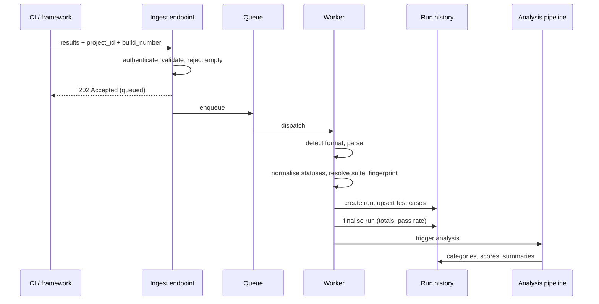

# Getting results in

Everything TestLookup knows starts here. This page covers every route in, what happens to a report after it arrives, and how to tell whether it worked.

## The routes in

| Route | How | Best for |
|---|---|---|
| **Upload in the app** | **Runs → Upload report** | Trying TestLookup, or a one-off report |
| **File upload over the API** | `POST /api/v1/ingest/file` | Reports your framework already writes, from CI |
| **JSON batch** | `POST /api/v1/ingest` | Custom harnesses, scripts, quick tests |
| **Streaming / live** | a reporter SDK, or `POST /api/v1/stream/ingest` | Long suites you want to watch as they run |
| **CLI** | `testlookup upload file` | CI pipelines with a shell step |

All of them authenticate with either an `X-API-Key` header or a signed-in session.

> **Who can send results.** Sending results needs the `QA_ENGINEER` role or above in that project, whatever the route; viewers and testers get `403`. An API key acts with its owner's role.

## Upload a report from the app

1. Open **Runs** and click **Upload report** (or go to `/runs?upload=1`).
2. Drop one or more report files, or click to browse: `.xml`, `.trx`, `.json` or `.zip`, up to **50 MB**. Several files are zipped together in the browser; a `.zip` must be uploaded on its own.
3. In **All Projects**, choose the **Project**. Otherwise the selected project is used.
4. Leave **Format** on **Auto-detect** unless detection gets it wrong.
5. Optionally open **Optional metadata** to set a **Build label**, **Release**, **Branch** and **Commit**. Without a build label, one is generated.
6. **Upload**. The dialog shows the report being processed, then **View run** opens it.

Ticking **Skip AI analysis** makes the upload faster; you can run the analysis later from the run's page.

The **Upload report** button is controlled by the `manual_upload` feature flag. It is **on** for a new install; an administrator can turn it off under **Settings → System → Feature flags**, for example to make CI the only way in. If the button is missing, that flag is off. If it is greyed out with "QA Engineer role required", your role is below `QA_ENGINEER`.

## API keys

Scripts, CI jobs and SDKs authenticate with an API key in the `X-API-Key` header:

- **My API keys** (`/settings/my-api-keys`; open **My profile** from the account menu and pick it from the side navigation) — keys you own, for your own scripts and pipelines. Any `QA_ENGINEER` or above can create them. Choose a name, an optional expiry (1–365 days) and optional scopes (`stream:write`, `project:write`, `project:admin`; none means full access).
- **Streaming API keys** (**Admin → Project → Streaming API keys**) — keys bound to one project, limited to streaming results (`stream:write`), with a 90-day expiry by default. Only an administrator can generate them; QA leads can see their own.
- Or `POST /api/v1/keys`.

A key is shown **once**; store it in your CI secret store straight away. It carries the permissions of the user who created it, narrowed by its scopes. Revoke a key from the page that lists it.

## Streaming while tests run

An uploaded report arrives after the suite finishes. A **reporter SDK** instead streams each test result as it completes, so the run appears on [Runs → Live](/docs/live) while it is still executing and its partial results are visible straight away. SDKs exist for Python (pytest), Java (TestNG and JUnit 5), JavaScript/TypeScript (Jest and Mocha) and Go; download them from **Connect a test runner** on the Live page. When the suite finishes, the SDK closes the session and the run is finalised like any other.

## Attaching a run to a release

A run joins a [release](/docs/releases) when it arrives with a release name: **Release** in the upload dialog, `release_name` on the API, `--release` on the CLI, or the SDK's release setting. A QA lead can also set or change it afterwards with **Set release** on the run's page.

## Supported formats

Format is detected from the **content**, not the filename. The parser dispatch lives in `worker/tasks.py`; the sniffing rules in `routers/ingest._detect_format`.

| Format | Detected by |
|---|---|
| **TestNG** | `<testng-results`, or a `configurationmethod` marker |
| **Robot Framework** | `<robot` root element |
| **NUnit 3** | `<test-run` root element |
| **Visual Studio TRX** | `<TestRun` plus the VisualStudio TeamTest namespace |
| **xUnit.net v2** | `<assemblies`, or `<assembly` with a `test-framework` attribute |
| **JUnit / Surefire** | `<testsuite` or `<testsuites` — also the default |
| **Playwright** | JSON with a top-level `config` containing `projects` |
| **pytest** (`--json-report`) | JSON with top-level `exitcode` **and** `root` |
| **Cypress** (Mochawesome) | JSON with top-level `stats` carrying `passes` / `failures` |
| **Cucumber** | JSON array of feature objects with `elements` |
| **Allure** | Allure result JSON (object or array) |
| **Archive** | A zip containing any of the above |

XML markers are checked before JSON, most-specific first. TRX in particular contains no `<testsuite` marker, so without its own rule it would fall through to the JUnit default and parse to **zero results** — the ordering is deliberate.

> **Note.** If your format is not listed, convert to JUnit XML (nearly every framework can emit it) or post a JSON batch directly.

## What happens after you send it



**In words:** the endpoint authenticates, validates and immediately returns **202 Accepted** — the work is queued, not done. A worker picks it up, detects the format, parses it, normalises each result, resolves the suite name, computes a fingerprint per test, creates the run and upserts the test cases, then finalises the run totals. Finalisation triggers the analysis pipeline, which writes categories, scores and summaries back.

> **Important.** `202` means *accepted*, not *stored*. A report that parses to zero results still returned 202. Always verify — see [Confirming it worked](#confirming-it-worked).

## Key behaviours

### Project and run resolution

`project_id` and `build_number` identify the run. A repeated `(project, build_number)` is **idempotent** — re-sending the same build updates the existing run rather than creating a second one. Useful for retries; surprising if you reuse build numbers across genuinely different runs.

> **Tip.** Idempotent here means *the duplicate is absorbed*, not *the row is overwritten wholesale*. Re-sending updates the run's timestamps but does not necessarily replace every scalar field.

### Test fingerprints

Each test gets a **fingerprint** — a stable identity derived from its name and location — so the same test can be followed across runs and branches. History, flakiness and regression detection all depend on it. Rename a test and its history follows the old fingerprint.

### Suite-name resolution

Suite comes from the report where present. When it is absent, TestLookup infers it, and for some frameworks the suite is only declared at session level. This is the most common source of "the suite name looks wrong" — see [Troubleshooting](/docs/troubleshooting).

An execution's suite is what the reporter sent, and nothing changes it afterwards: moving a test to another suite in the catalogue (**Fix tagging** on Coverage, **Move** on a suite's page) files the test under that suite for Test Management, Suites and the coverage map, but its executions — past and future — keep the label they arrived with. To label future runs, set the suite in your reporter (the suite name in the report itself, or the SDK reporters' `TESTLOOKUP_SUITE` / `testlookup.suite` default for records that name none).

### Status normalisation

Framework-specific outcomes are mapped onto a common vocabulary — passed, failed, broken, skipped, unknown. **Broken** (an error rather than an assertion failure) is kept distinct from **failed**, because they mean different things when you are triaging.

### Empty and malformed input

A zero-byte upload is rejected with **400** rather than accepted. Earlier behaviour accepted it, auto-detected it as JUnit, and parsed it to zero results — success reported, nothing ingested. A parse error is recorded as a parse error rather than surfacing as an empty run.

## Confirming it worked

1. **Runs** should list your `build_number` within seconds.
2. Open it — per-test rows with statuses and durations.
3. Or via API:

```bash
curl -s -H "X-API-Key: $TESTLOOKUP_API_KEY" \
  "$TESTLOOKUP_URL/api/v1/runs?project_id=<uuid>&size=10"
```

Returns `{"items": [...], "total": N, "page": 1, "size": 10, "pages": N}`.

> **Tip.** Listings default to the **last 30 days** and exclude runs belonging to deleted projects. Pass `days=0` for all time. If a run is missing, check the window and the project before assuming ingestion failed.

## CI integration

The pattern is the same everywhere: run tests, then post the report. With the CLI (installed from the repository's `cli/` folder):

```bash
testlookup upload file reports/junit.xml --project "$TESTLOOKUP_PROJECT" --build "$CI_BUILD_NUMBER"
```

Or with `curl`:

```bash
# after your test step, regardless of its exit code
curl -sf -X POST "$TESTLOOKUP_URL/api/v1/ingest/file" \
  -H "X-API-Key: $TESTLOOKUP_API_KEY" \
  -F "project_id=$TESTLOOKUP_PROJECT" \
  -F "build_number=$CI_BUILD_NUMBER" \
  -F "branch=$CI_BRANCH" \
  -F "file=@reports/junit.xml"
```

> **Important.** Run the upload step **even when tests fail** — that is exactly the run you want recorded. In most CI systems that means an `always()` / `if: always()` condition.

Store the API key in your CI secret store. See [API, CLI, SDKs and MCP](/docs/integrations).

The SDKs and the CLI also attach **CI context** (repository, pull-request number, a link back to the CI run) and, from the CLI and Python SDK, the **commit range** since the base branch, which powers pull-request comments and suspect-commit ranking. Pipeline recipes for those, and for failing a build only on real (non-quarantined) failures, are in the operator guide in the repository (`user-guide/getting-results-in.md` and `user-guide/flaky-tests.md`).

## Troubleshooting

| Symptom | Likely cause | Check |
|---|---|---|
| 202 but no run | Still queued, or parsed to zero results | Wait, refresh; confirm the report has test entries |
| 400 "empty" | Zero-byte file, usually a wrong path | `ls -l` the file locally |
| Run exists, no tests | Format detected but no cases found | Open the report; check it is not a summary-only file |
| Wrong format detected | Missing a distinctive marker | Send with an explicit format, or convert to JUnit |
| Suite names wrong | Suite absent from the report | See suite resolution above |
| 401 | Bad or missing key | Confirm the header is `X-API-Key` |

## Related

- [Getting started](/docs/getting-started)
- [Concepts and terminology](/docs/concepts)
- [Troubleshooting](/docs/troubleshooting)
