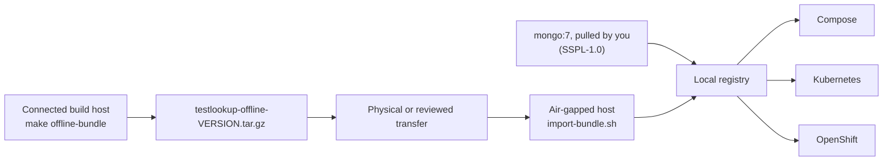

# Air-gapped install

Installing TestLookup on a network that cannot reach Docker Hub, GHCR, PyPI or
npm — a classified enclave, a regulated production segment, or any site where
egress is blocked by policy.

The mechanism is an **offline install bundle**: one tarball containing every
container image TestLookup redistributes, the Kubernetes manifests, the Compose
files, licence texts, checksums, and an import script. You build it once on a
connected host, carry it across the boundary, and import it on the other side.
Nothing in the install path touches the internet.

One dependency is deliberately **not** in the bundle: **MongoDB** (licensed
SSPL-1.0). It is an external prerequisite that you mirror into your registry
yourself — see [§2a](#2a-not-in-the-bundle-mongodb).



---

## 1. What you need

**On the build host** (has internet + your container engine):

| Requirement | Notes |
|---|---|
| `docker` (or `podman`) | Podman works unchanged — the scripts only use flags both implement. `DOCKER=podman` if it isn't behind a `docker` shim. |
| `bash`, `tar`, `gzip` | Git Bash is fine on Windows. |
| `sha256sum` / `shasum` / `openssl` | Required. The build **fails** rather than shipping an unverifiable bundle. |
| `kubectl` or `kustomize` | Optional — used to pre-render the Kubernetes manifests. Without it the bundle ships the raw Kustomize sources instead. |
| `syft` | Optional but **strongly recommended** — this is what puts real SBOMs in the bundle. See [§7](#7-sboms-what-you-actually-get). |
| Disk | ~8 GB free (~3 GB bundle, plus the images in the engine's store). |

**On the air-gapped side:**

| Requirement | Notes |
|---|---|
| `docker` (or `podman`) | To `docker load` the images. |
| A container registry the target can pull from | Harbor, Artifactory, Nexus, the OpenShift internal registry, a plain `registry:2` — anything. Compose can also run straight off the loaded local images. |
| MongoDB 7 image in that registry | Not in the bundle — mirror it yourself ([§2a](#2a-not-in-the-bundle-mongodb)). |
| `kubectl` / `oc` | Kubernetes and OpenShift targets only. |

---

## 2. What is in the bundle

```
testlookup-offline-<version>/
├── README.md                  # a condensed copy of this procedure
├── MANIFEST.json              # images, sha256, image ids, per-image SBOM status,
│                              #   external_prerequisites (images NOT shipped)
├── images.manifest.txt        # the source-of-truth manifest it was built from
├── checksums.sha256           # every other file in the bundle
├── images.list                # "<tar>\t<image ref>" — what import-bundle.sh reads
├── images/*.tar               # one `docker save` archive per image
├── sbom/*.spdx.json           # only when the build host had syft
├── compose/                   # docker-compose.release.yml + .airgap.yml + .env.example
├── k8s/testlookup-airgap.yaml # rendered manifests, placeholders intact
├── k8s/base/, k8s/overlay/    # raw Kustomize sources, for customizing
├── LICENSE, NOTICE, THIRD_PARTY_NOTICES.md   # licence texts
└── import-bundle.sh           # verify → load → retag → push → next steps
```

**Images included** (default, `core`):

| Image | Role | Licence |
|---|---|---|
| `testlookup/backend` | API + Celery workers + beat + seed job + bucket setup (all one image) | Apache-2.0 (+ Debian base layers) |
| `testlookup/frontend` | nginx serving the SPA | Apache-2.0 (+ Alpine base layers) |
| `testlookup/mcp` | MCP server (SSE) | Apache-2.0 (+ Debian base layers) |
| `postgres:16-alpine` | relational store | PostgreSQL License |
| `valkey/valkey:8.1-alpine` | Celery broker, cache, live-event streams — the `redis` service ([§8b](#8b-broker-valkey)) | BSD-3-Clause |
| `ghcr.io/versity/versitygw:v1.8.0` | S3 object store — the `minio` service ([§8](#8-object-storage-versitygw)) | Apache-2.0 |
| `busybox:1.36` | worker init containers on Kubernetes | GPL-2.0 |

`ollama/ollama` and `chromadb/chroma` are **opt-in** — add `--with-llm`. They add
roughly 2 GB and are only useful if you also transfer the model blobs
separately ([§9](#9-local-llm-in-an-air-gap)).

Every one of these comes from **`deploy/images.manifest.txt`**, the single
source of truth. Compose, the Kubernetes manifests, the OpenShift overlay and
the mirror scripts are all checked against it in CI, so the bundle cannot
silently miss an image the deployment needs. Bucket creation needs no extra
image: it is `scripts/s3_setup.py` inside the backend image.

### 2a. Not in the bundle: MongoDB

TestLookup stores documents in **MongoDB 7** (`mongo:7`), which compose and the
Kubernetes manifests reference exactly as before. MongoDB Community Server is
licensed under the **Server Side Public License (SSPL-1.0)**, which is not an
OSI-approved licence, so the bundle does not redistribute it. In the manifest
it is the bundle class `external`; the bundle's `README.md` and `MANIFEST.json`
(`external_prerequisites`) list it, and `import-bundle.sh` prints the commands
below.

Review the SSPL against your organisation's policy, then mirror the image
yourself, under the same naming contract as everything else
(`<registry>/mongo:7`):

```bash
# connected host
docker pull mongo:7
docker save -o mongo-7.tar mongo:7
sha256sum mongo-7.tar > mongo-7.tar.sha256

# air-gapped host, after transfer
sha256sum -c mongo-7.tar.sha256
docker load -i mongo-7.tar
docker tag mongo:7 registry.internal/mongo:7
docker push registry.internal/mongo:7
```

If your registry can proxy Docker Hub from the connected side, mirroring it
there works just as well. `openshiftsetup/mirror-images.sh` (and
`make k8s-deploy-openshift-artifactory`) include it automatically, because they
run on your connected host and pull from upstream.

---

## 3. Build the bundle (connected host)

```bash
git clone https://github.com/test-intelligence/testlookup && cd testlookup

# Optional but recommended — this is what produces real SBOMs:
#   https://github.com/anchore/syft   (install it before building)

make offline-bundle
```

Output:

```
dist/testlookup-offline-0.1.0.tar.gz
dist/testlookup-offline-0.1.0.tar.gz.sha256
```

Useful flags (`make offline-bundle ARGS="…"`):

| Flag | Why |
|---|---|
| `--version 1.2.3` | Override the tag baked into the app images (defaults to the `VERSION` file). |
| `--created-at 2026-08-03T00:00:00Z` | Pin the bundle timestamp. **Pass this from your release pipeline** — otherwise the wall clock goes in and two builds of the same commit differ. |
| `--with-llm` | Add Ollama + ChromaDB. |
| `--skip-build` | Reuse app images already in the local engine. |
| `--dry-run` | Print the plan (also `make offline-bundle-plan`). |

Preview what would be shipped without building anything:

```bash
make offline-bundle-plan
```

The plan lists the images that will be saved and, separately, the external
prerequisites that will **not** be (`mongo:7`).

### Reproducibility

With the same commit, the same images and the same `--created-at`, the bundle
is byte-for-byte identical file by file — the assembly step contributes no
timestamps or ordering of its own (GNU `tar --sort=name` + `gzip -n`). What is
*not* reproducible is the container build itself: `pip`/`apt` resolve fresh
layers. If you need a bit-identical artifact across two runs, build the images
once and re-run with `--skip-build`.

---

## 4. Transfer and verify

Carry **both** files across. On the far side, before anything else:

```bash
sha256sum -c testlookup-offline-0.1.0.tar.gz.sha256
tar xzf testlookup-offline-0.1.0.tar.gz
cd testlookup-offline-0.1.0

./import-bundle.sh --verify-only        # checks every file in the bundle
```

`--verify-only` reads `checksums.sha256` and stops. It **fails closed**: a
mismatch, or the absence of any sha256 tool, aborts the install. Do not use
`--skip-verify` for a production install.

---

## 5. Import

```bash
./import-bundle.sh \
    --registry registry.internal \
    --username <user> --password <pass> \
    --push
```

What happens, in order:

1. checksums verified (again — the import is the gate, not just the unpack);
2. every `images/*.tar` is `docker load`ed. **This never contacts a registry**,
   which is what makes the step work with zero egress;
3. each image is retagged into your registry;
4. with `--push`, they are pushed there;
5. the Kubernetes manifests are rendered with your registry substituted in;
6. the external prerequisites (`mongo:7`) are listed with the commands to
   mirror them, followed by the exact next commands for each target.

### The naming contract

`--registry` is a **base**. Images land at `<base>/<ref>`:

```
--registry registry.internal
    → registry.internal/testlookup/backend:0.1.0
    → registry.internal/postgres:16-alpine
    → registry.internal/valkey/valkey:8.1-alpine
    → registry.internal/ghcr.io/versity/versitygw:v1.8.0
    → registry.internal/mongo:7          (mirrored by you, §2a)
```

An image that comes from a registry other than Docker Hub keeps its registry
host as the first path segment (`ghcr.io/…`), so names can never collide.

A repository path is fine (`artifactory.example.com/testlookup-docker`). Do
**not** append `/testlookup` yourself — the app refs already carry it. This is
the same layout `openshiftsetup/mirror-images.sh` uses, so one mirrored
registry serves Compose, Kubernetes and OpenShift identically.

Without `--push`, the images are only retagged locally — enough for the Compose
target on the same host, not enough for a cluster.

---

## 6. Deploy

### 6a. Docker Compose

```bash
cd compose
bash scripts/gen-dev-env.sh            # or copy .env.example and fill it in

cat >> .env <<'ENV'
TESTLOOKUP_REGISTRY=registry.internal
TESTLOOKUP_VERSION=0.1.0
ENV

docker compose -f docker-compose.release.yml -f docker-compose.airgap.yml up -d
```

`docker-compose.airgap.yml` is the piece that makes Compose air-gap-capable.
`docker-compose.release.yml` alone names Docker Hub (postgres, mongo, valkey)
and GHCR (versitygw) with no way to redirect them; the override re-points
**every** image — app and third-party, MongoDB included — at
`$TESTLOOKUP_REGISTRY`, so `registry.internal/mongo:7` must exist (§2a). Both
variables are mandatory: Compose refuses to start rather than silently falling
back to `docker.io`, which is the exact failure this file prevents.

The one-shot `minio-setup` service runs `scripts/s3_setup.py` from the backend
image: it waits for the object store and creates every bucket the backend
writes to. It is idempotent; re-run it with
`docker compose -f docker-compose.release.yml -f docker-compose.airgap.yml run --rm minio-setup`.

`make dev` and the public `install.sh` one-liner are unaffected — they never
load the override.

Then confirm:

```bash
docker compose -f docker-compose.release.yml -f docker-compose.airgap.yml ps
curl -f http://localhost:8000/health/ready
```

### 6b. Kubernetes

```bash
kubectl create namespace testlookup

kubectl -n testlookup create secret docker-registry local-registry \
    --docker-server=registry.internal \
    --docker-username=<user> --docker-password=<pass>
kubectl -n testlookup patch serviceaccount default \
    -p '{"imagePullSecrets":[{"name":"local-registry"}]}'

# Application secrets — generate your own; nothing is baked into the bundle.
kubectl -n testlookup create secret generic testlookup-secrets \
    --from-literal=APP_SECRET_KEY="$(openssl rand -hex 32)" \
    --from-literal=JWT_SECRET_KEY="$(openssl rand -hex 32)" \
    --from-literal=POSTGRES_PASSWORD="$(openssl rand -base64 18 | tr -d '=/+')" \
    --from-literal=DATABASE_URL="postgresql+asyncpg://testlookup_user:<pg-password>@testlookup-postgres:5432/testlookup" \
    --from-literal=MONGO_URI="mongodb://testlookup-mongo:27017" \
    --from-literal=MINIO_ACCESS_KEY="testlookup_minio" \
    --from-literal=MINIO_SECRET_KEY="$(openssl rand -base64 18 | tr -d '=/+')" \
    --from-literal=WEBHOOK_SECRET="$(openssl rand -hex 32)"

backend_image="<registry>/testlookup/backend:<bundle-version>"
had_backend=0
if kubectl -n testlookup get deployment testlookup-backend >/dev/null 2>&1; then
    had_backend=1
    bash ./run-k8s-migrations.sh testlookup "$backend_image"
fi
kubectl apply -f k8s/testlookup-airgap.rendered.yaml
if [ "$had_backend" -eq 0 ]; then
    bash ./run-k8s-migrations.sh testlookup "$backend_image"
fi
kubectl -n testlookup rollout status deploy/testlookup-backend --timeout=300s

# Create the S3 buckets (idempotent; uses the pod's own MINIO_* settings).
kubectl -n testlookup exec deploy/testlookup-backend -- python /app/scripts/s3_setup.py
```

The MongoDB pod pulls `registry.internal/mongo:7`: mirror it first (§2a) or it
stays in `ImagePullBackOff`.

Re-run `import-bundle.sh` with `--storage-class <your class>` if the rendered
file still contains `STORAGE_CLASS_PLACEHOLDER`; the script warns and lists any
placeholder it could not resolve rather than letting you apply a broken
manifest.

To customize before applying, edit `k8s/overlay/` and re-render:

```bash
kubectl kustomize k8s/overlay > my-manifests.yaml
```

### 6c. OpenShift

Everything from 6b, plus:

```bash
oc adm policy add-scc-to-user anyuid -z default -n testlookup
# Run the Kubernetes sequence above with KCLI=oc and oc in place of kubectl.
```

The stock infra images (postgres, mongo, valkey, versitygw, nginx) run as fixed
UIDs and need `anyuid` under `restricted-v2`. The rendered manifests already
contain the OpenShift **Routes** (edge TLS, HTTP→HTTPS redirect). Supply the
hostnames at import time:

```bash
./import-bundle.sh --registry registry.internal --push \
    --apps-domain apps.ocp.example.com \
    --storage-class ocs-storagecluster-ceph-rbd
```

If your build host *can* reach both the internet and the cluster's registry,
the older registry-to-registry path is still available and does the same job
without a tarball — it also mirrors `mongo:7` from upstream, creates the
buckets, and generates the first admin password (printed once at the end):

```bash
make k8s-mirror-images-openshift          # seed Artifactory
make k8s-deploy-openshift-artifactory     # build, push, deploy
```

The offline bundle exists for the case that host does **not** exist.

---

## 7. SBOMs: what you actually get

`MANIFEST.json` records an SBOM status **per image**, and the bundle never
implies an SBOM exists when it does not.

| `sbom_mode` | Meaning |
|---|---|
| `syft` | Real SPDX SBOMs under `sbom/`, one per image, generated on the build host. Each image entry points at its file. |
| `unavailable` | **No SBOMs in this bundle.** Every image entry carries an explicit `"status": "unavailable"` with the reason. |

The reason `unavailable` is even possible: the published GHCR images *do* carry
BuildKit SBOM and provenance attestations (`.github/workflows/release.yml`
builds with `sbom: true`, `provenance: mode=max`), but those attestations live
in the **registry manifest list** — `docker save` copies image layers and
config, not attestations. There is no way to carry them into a tarball as-is.

So, to get SBOMs into a bundle, do one of:

- **install [syft](https://github.com/anchore/syft) on the build host** before
  running `make offline-bundle` (the supported path); or
- while still connected, export the attestation separately and hand it over
  with the bundle:

  ```bash
  docker buildx imagetools inspect \
      ghcr.io/test-intelligence/testlookup/backend:<tag> --format '{{json .SBOM}}' \
      > backend.sbom.json
  ```

The `sha256` values in `MANIFEST.json` are checksums **of the tar files** —
they verify the transfer. `image_id` is the image config digest reported by the
container engine, and `repo_digest` is the registry digest when the image was
pulled rather than built locally.

---

## 8. Object storage: versitygw

The S3 object store is **[versitygw](https://github.com/versity/versitygw)**
(`ghcr.io/versity/versitygw:v1.8.0`, Apache-2.0), a single-binary S3 gateway
run with its **posix** backend: buckets are directories and objects are plain
files on the data volume. It replaced the AGPL-3.0 MinIO fork (PGSTY Silo) and
its `mc` client.

| What | Detail |
|---|---|
| Names | Unchanged: the Compose service is still `minio`, the Kubernetes objects `testlookup-minio` / PVC `minio-data`, and every `MINIO_*` setting means "the S3 endpoint". Existing configuration keeps working. |
| Port | `9000` (S3 API). There is **no web console** — port 9001 is gone. |
| Credentials | `ROOT_ACCESS_KEY` / `ROOT_SECRET_KEY`, fed from `MINIO_ACCESS_KEY` / `MINIO_SECRET_KEY`. |
| Data location | `/data/s3` on the volume mounted at `/data` (created at start). An old MinIO/Silo data directory in `/data` is never read or modified. |
| Health | `GET /health` → 200, unauthenticated. TestLookup's own storage health check accepts this route and the legacy `/minio/health/live`. |
| Filesystem | The data volume must support **user extended attributes** (ext4, xfs, btrfs and most CSI block volumes do). On a filesystem without them (some NFS setups), set `VGW_META_SIDECAR` to an existing directory on the volume. |
| Buckets | Created by `scripts/s3_setup.py` in the backend image (Compose: the `minio-setup` service; Kubernetes: `kubectl exec … python /app/scripts/s3_setup.py`). |
| Bucket notifications | Not wired. TestLookup's API dispatches ingestion itself; the legacy direct-to-bucket path (`/webhooks/minio`) needs a notification sender that can present `Authorization: Bearer <WEBHOOK_SECRET>`, which versitygw's webhook cannot. Keep an S3 store that can (e.g. your existing MinIO) if you depend on it. |

**Upgrading an install that ran MinIO/Silo:** versitygw does not read MinIO's
on-disk format. Copy the objects over the S3 API with the setup script, from a
temporary instance of the old server — see `UPGRADING.md` for the full
procedure:

```bash
export S3_COPY_FROM_ACCESS_KEY=<old access key>
export S3_COPY_FROM_SECRET_KEY=<old secret key>
python /app/scripts/s3_setup.py --copy-from-endpoint http://<old-s3-host>:9000
```

It creates the buckets, streams every object across with its content type and
metadata, and skips objects already copied, so it is safe to re-run.

### 8b. Broker: Valkey

The Celery broker, cache and live-event store is **Valkey 8.1**
(`valkey/valkey:8.1-alpine`, BSD-3-Clause), the Linux Foundation fork of Redis
7.2. It speaks the same protocol, so the `redis` service, the
`testlookup-redis` objects and every `redis://` URL and `REDIS_*` setting are
unchanged. It replaced `redis:7-alpine`, whose 7.4 releases are licensed
RSALv2/SSPLv1. Valkey cannot load the data files of Redis 7.4 or later: an
existing install drains its queues and starts Valkey on an empty volume — see
`UPGRADING.md`.

## 9. Local LLM in an air-gap

`--with-llm` bundles the Ollama and ChromaDB **images**, not the models. Model
blobs (4–14 GB each) must be transferred separately — the full procedure,
including how to verify the result from TestLookup, is the
[offline model pack](offline-model-pack.md). In short:

```bash
# connected host — the exact tags TestLookup's defaults name (both Apache-2.0)
docker run -d --name ollama-pack -v ollama_models:/root/.ollama ollama/ollama:0.5.4
docker exec ollama-pack ollama pull qwen2.5:7b-instruct
docker exec ollama-pack ollama pull nomic-embed-text:v1.5
docker rm -f ollama-pack
docker run --rm -v ollama_models:/root/.ollama -v "$PWD":/out busybox:1.36 \
    tar czf /out/ollama-models.tar.gz -C /root/.ollama .
# air-gapped host: restore that tarball into the ollama_models volume / PVC
```

Without models, TestLookup degrades exactly as designed: `ANALYSIS_MODE=auto`
falls back to the ML classifier and then the rules engine. `AI_OFFLINE_MODE`
defaults to `true`, so no outbound integration is attempted regardless.

---

## 10. Troubleshooting

| Symptom | Cause / fix |
|---|---|
| `CHECKSUM MISMATCH` on import | The bundle was corrupted or altered in transit. Re-transfer; do not install it. |
| `No sha256 tool available` | Install `coreutils` or `openssl` on the target. `--skip-verify` exists but leaves you unverified. |
| `ImagePullBackOff` / pull error for `<registry>/mongo:7` | MongoDB is not in the bundle. Mirror it (§2a). |
| `ImagePullBackOff` referencing `docker.io/...` | Something bypassed the retag. On Compose, you forgot `-f docker-compose.airgap.yml`; on Kubernetes, you applied the raw overlay instead of the rendered file. |
| `..._PLACEHOLDER` in a manifest | Re-run `import-bundle.sh` with `--storage-class` / `--apps-domain`. The placeholders deliberately do not resolve so an un-rendered apply fails loudly instead of pulling from the wrong registry. |
| Compose exits with "TESTLOOKUP_REGISTRY must be set" | Working as designed — set both `TESTLOOKUP_REGISTRY` and `TESTLOOKUP_VERSION` in `.env`. |
| `testlookup-minio` restarts with `xattr check failed` | The data volume has no user extended attributes. Use a filesystem that does, or set `VGW_META_SIDECAR` (§8). |
| Uploads fail with `NoSuchBucket` | The buckets were never created. Run `scripts/s3_setup.py` (§6a / §6b). |
| `testlookup-redis` / `redis` exits right after an upgrade, log mentions the RDB format | An old Redis 7.4 AOF/RDB is on the volume. Follow `UPGRADING.md` (drain, then start Valkey on an empty volume). |
| Infra pods `CrashLoopBackOff` on OpenShift | `anyuid` was not granted (§6c). |
| Bundle build fails pulling images | The build host lost internet, or a TLS-intercepting proxy is in the way — see [DEPLOYMENT.md §5](../architecture/DEPLOYMENT.md). |

---

## 11. For maintainers

- **`deploy/images.manifest.txt`** is the single source of truth for images.
  Add or bump an image there **first**, then update the surfaces. Its fourth
  column decides what the bundle carries: `core`, `llm` (with `--with-llm`),
  `external` (a prerequisite the bundle does not redistribute — the operator
  mirrors it), `excluded` (tracked for drift only).
- `make images-check` (CI job **Images — Manifest drift**) asserts Compose, the
  Kubernetes manifests, the `openshift-artifactory` overlay and the OpenShift
  mirror scripts all agree with it, and that no compose file carries a floating
  `:latest`.
- `make images-check-test` runs the guard's own regression tests — they prove
  it fails on drift, not just that it passes today.
- The **Offline bundle** workflow builds a bundle with the network on, then
  verifies checksums, `docker load`, retag and an offline application-module
  import inside `--network none` containers, and that the bundle carries
  Valkey and versitygw but not MongoDB. It proves *bundle integrity and offline
  import*, not a full-stack end-to-end deployment.

## Related

- [architecture/DEPLOYMENT.md](../architecture/DEPLOYMENT.md) — every deployment topology
- [user-guide/offline-model-pack.md](./offline-model-pack.md) — local models in an air gap
- [user-guide/administration.md](./administration.md) — backup, restore, upgrades
- [user-guide/sizing.md](./sizing.md) — capacity planning
